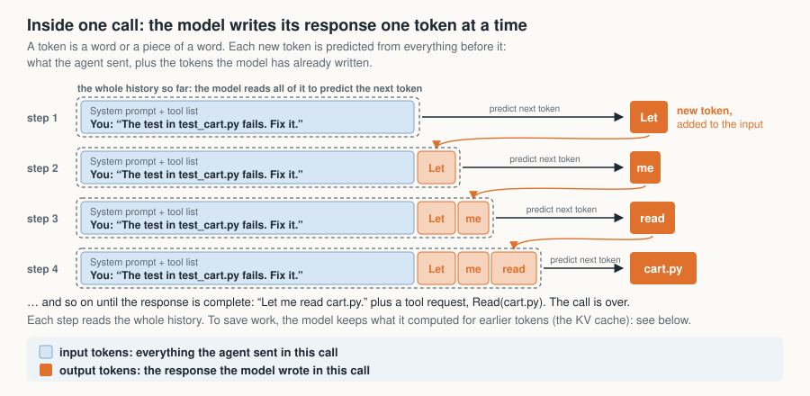
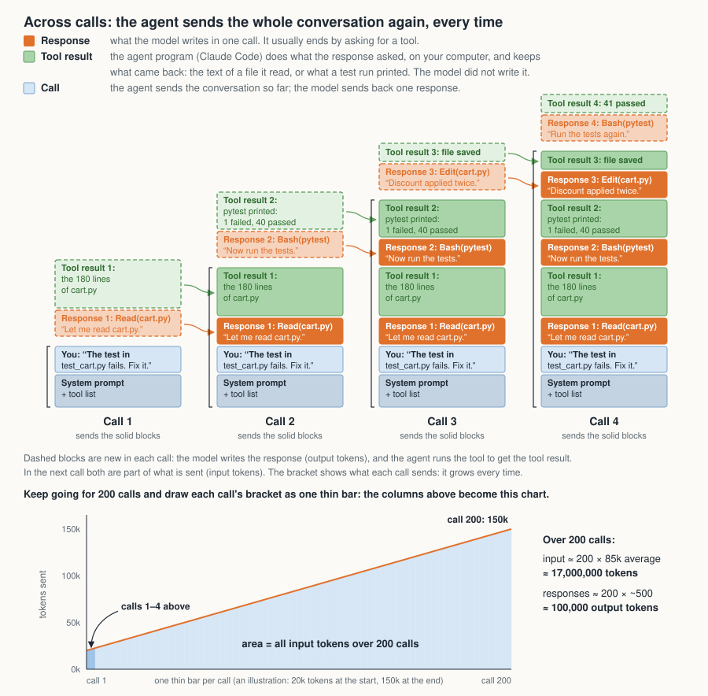

## Summary

Coding agents use a lot of tokens. When I started running four parallel agents on one project, a week's token budget did not last the week. Ten weeks and six changes later, a changed line of code takes less than a third of the tokens it did (3.3x fewer), and a merged PR less than a fifth (5.5x fewer).

This article shows where the tokens went, how I measured that from the transcripts Claude Code already keeps on disk, and which changes paid off and which did not. [A companion article](/ai-tools/one-developer-coding-agent-fleet/) describes the project itself and how its code is kept under control.

Measured over ten weeks of transcripts:

- **The same code takes less than a third of the tokens.** Tokens per changed line fell 3.3x, or about 2.5x weighted by the price of each kind of token. This is the headline figure because it does not depend on how the work is split into PRs.
- **PRs also got smaller, so tokens per PR fell further.** The average PR went from about 1,400 to 850 changed lines (1.65x smaller), because each agent now does one task. With the 3.3x per line, that makes tokens per merged PR about 5.5x lower (3.3 × 1.65).
- **Merged PRs per week rose 4.4x**, on about the same weekly spend weighted by the price of each kind of token. The saving went into more work, not a smaller bill.
- **Reverts stayed rare** (0.2 to 0.7% of merges), but rework per PR rose slightly, from 0.8 to about 1 fix round per merged PR.

Most of the tokens are not the code the agents write but the context they send. The model keeps nothing between calls, so each call sends the whole conversation again, and an agent makes many calls per task. The total is proportional to the number of calls times the average context per call. Every improvement came from making fewer calls or sending less context with each one. The list below shows what I changed and the impact of each change (the terms are explained in the sections that follow):

1. **Measure from the transcripts**, per merged PR, not per hour. It found the levers, including the largest, which my own tuning had missed for weeks: cache expiry while agents waited, 31% of agent usage.
2. **End each agent after one task**, with a written handoff and a hook-enforced context ceiling. Together with change 3, this was the big step. On the ceiling's first day, median context per request, across all kinds of agent, fell from 218k to 101k tokens.
3. **Keep the prompt cache warm**, and load less into every agent. Cache expiry fell from 31% of agent usage to 0.7%.
4. **Turn rules into code**, so the model does not have to remember them. No separate number.
5. **Let a program take load off the AI** for the routine work of running the fleet. The coordinator's tokens per merged PR fell to 7% of their baseline.
6. **Make the codebase easy for a new developer**, because every agent is one. No separate number.

The principle behind all six: don't make the model remember; make the system remember.

This is one project, run by one person, with several changes landing at once. Where I cannot separate their effects, I say so.

## What to do first

The arithmetic is the same for one session as for a dozen agents. Without a fleet, these five steps cover most of it:

- **Measure.** [The script in the appendix](#appendix-a-script-to-sum-tokens-per-session) sums each session's tokens from the transcripts Claude Code keeps under `~/.claude/projects/`, counting each request once.
- **One task per session.** Start fresh for the next task, with a short note of where you are; a long conversation re-reads everything on every call.
- **Don't leave a session idle past its cache lifetime** (five minutes for sub-agents, the background agents a session launches; up to an hour for the main session), and run anything slow in the background.
- **Keep what loads into every session small**: only the rules that apply everywhere, with pointers to the rest.
- **Make the codebase easy to navigate**: short module summaries, small files, comments that point to the details.

On the session from which I run the fleet (the coordinator, described next), a few days old, that script shows about 3,600 calls and more than 200 cache-read tokens for every output token. That ratio is the subject of this article. The gates and the scheduling program below pay off only with many agents on a large, rule-heavy repository.

## The setup

One coordinating session, the coordinator, watches the work. Up to a dozen background agents on a single cloud VM each take one GitHub issue, write the change and its tests in their own clone, and open a pull request. A separate review agent, told to look for reasons *not* to merge, must approve every PR at its current head commit, and the PR then lands through a merge queue with green CI.

The main repository is a multi-service search solution, mostly Python and TypeScript, with about 1,400 files of solution code, about 600 of scripts and tooling, and 136 CI jobs. The agents also work in three smaller repositories: a data generator, a configuration-and-data repository and the agent-control repository. The fleet now merges 590 to 870 PRs a week across the four.

## The results

The figures come from one script over every transcript since September. Every token counts once: fresh input, cache writes, cache reads and output (the cache terms are explained in ["Why agents use so many tokens"](#why-agents-use-so-many-tokens)). The script was checked against an independent count I made at the start, for 15 September to 3 October, and agreed within 2.3%. Weeks are ISO weeks, Monday to Sunday: W36 starts on 31 August, W41 on 5 October, and W45 is partial, to 7 November.

Changed lines are additions plus deletions, from all four repositories. A few PRs a week regenerate data files and change tens of thousands of lines, so for tokens per line, a PR counts at most 5,000 lines.

I report token use relative to a baseline rather than as absolute counts, by choice: the ratios transfer to any budget, the counts do not. In the table, each token column is an index: 100 is its value over the four weeks before the changes, W36–W39, taken together. A value of 25 means a quarter of the baseline's tokens for the same unit of work; 135 means 35% more. "All tokens in the week" is every token used by the coordinator and every agent that week, across all four repositories; the other token columns divide it by merged PRs or changed lines. The [script in the appendix](#appendix-a-script-to-sum-tokens-per-session) measures your own absolute figures.

| Week | Merged PRs (all / main repo) | All tokens in the week (vs baseline = 100) | Tokens per main-repository PR (vs baseline = 100) | Tokens per merged PR, all repos (vs baseline = 100) | Median PR size (lines) | Tokens per changed line (vs baseline = 100) |
|---|---|---|---|---|---|---|
| W36 | 195 / 195 | 109 | 76 | 86 | 915 | 99 |
| W37 | 153 / 153 | 90 | 80 | 90 | 998 | 96 |
| W38 | 113 / 96 | 72 | 101 | 97 | 1,132 | 85 |
| W39 | 151 / 100 | 129 | 175 | 131 | 1,078 | 114 |
| **Baseline: W36–W39 together** | **612 / 544** | **100** | **100** | **100** | | **100** |
| W40 (changes begin) | 196 / 171 | 115 | 91 | 90 | 1,132 | 68 |
| W41 | 632 / 508 | 68 | 18 | 16 | 489 | 25 |
| W42 | 871 / 522 | 135 | 35 | 24 | 467 | 36 |
| W43 | 587 / 253 | 69 | 37 | 18 | 347 | 39 |
| W44 | 670 / 281 | 66 | 32 | 15 | 394 | 25 |
| W45 (partial) | 641 / 330 | 66 | 27 | 16 | 411 | 27 |

**Before** (W36–W39): the baseline, 100 in every token column, at about 150 merged PRs a week.

**After** (W41–W45), against that baseline: tokens per main-repository PR at 29 (3.5x fewer), per merged PR across all repositories at 18 (5.5x fewer), per changed line at 30.6 (3.3x fewer), and all tokens in the week at 81 (19% fewer), at about 680 merged PRs a week.

### Why the headline is per line, not per PR

Smaller PRs alone would lower tokens per PR without any real gain. Tokens per changed line do not depend on how the work is split into PRs, so they are the headline figure. They fell 3.3x: the same amount of changed code now takes less than a third of the tokens.

Raw tokens count a cache read the same as an output token, although a cache read costs a tenth as much or less. Weighted by the relative price of each kind of token (cache read 0.1, fresh input 1, cache write 1.25 to 2, output 5), the per-line drop is about 2.5x rather than 3.3x, because what fell is mostly the cheap kind. Output's share of the weighted total rose from 2–6% before to about 19% after.

PRs did get smaller. The median, across all four repositories, fell from about 1,010 changed lines to about 420 (the main repository alone was 492 in October), and the average, with each PR capped at 5,000 lines, from about 1,400 to about 850. One task per agent produces smaller PRs, which are easier to review. That is why the per-PR figures fell further than the per-line one.

Part of the smaller PR size is a shift in the mix: the main repository was 89% of merged PRs before and 56% after, and PRs in the smaller repositories are smaller (configuration and data changes). So the 5.5x partly reflects what was merged, not only how it was done. The 3.5x avoids that by charging every token, including those spent in the other three repositories, to main-repository PRs alone. That overstates the cost per PR after the change, so 3.5x is the conservative figure. W45 is partial: the complete weeks W41–W44 alone give 3.4x for tokens per main-repository PR.

### What changed, and what I cannot separate

Almost all of the drop happened between W40 and W41. Two changes landed together: short-lived agents with a hook-enforced context ceiling, and a cap on waits that stopped cache expiry. I did not run them separately, so I cannot divide the step between them. The direct evidence is the context distribution: on the first day of the ceiling, the median context per agent request fell from 218k to 101k tokens.

The model mix changed too, but earlier. By W40, 92% of tokens were already on the newer generation of Claude Opus, the largest model, and tokens per main-repository PR were still near the old level, so the generation change alone did not produce the step. In W41 a smaller model also took 27% of tokens, and 69% in W42.

Per changed line, W40 was already at 68, so part of the per-line drop belongs to that week, when the newer model generation arrived and PRs were larger. The step from 68 to 25 is the one I attribute to the ceiling and the wait cap.

The later weeks moved for reasons I also did not isolate. W42 and W43, the weeks with the highest tokens per PR after the step, are the weeks a smaller model carried more than half the tokens; implementation then went back to the strongest model for quality. As the easy issues ran out, the remaining ones were larger, which pushes the per-PR figure up. Cache writes per merged PR more than halved from W41 to W45, as the later cache fixes took hold.

### What did not change, or got worse

- **What the agents write did not fall.** Output tokens are everything the model writes, and code is only a small part of it. Measured from the transcripts, about half of the output is the model reasoning before it acts, about a third is the commands it runs (tests, git, searches), and about a tenth is the file edits themselves; replies, PR comments and handoff notes are under a tenth together. Much of that is a fixed cost per task: understanding the issue, running the tests, opening the PR.
- **Reverts** rose from 0–1 a week to 2–4 a week in W42–W44, 0.2 to 0.7% of merges at four times the volume.
- **Fix rounds per merged PR rose**, from 0.80 to 0.9–1.0. A fix round is one pass of: a reviewer blocks the PR, an agent fixes what it found, and the PR is reviewed again. My weekly token reports put this rework at about 20% of agent tokens.
- **Reviews started on PRs whose CI had already failed.** A reviewer that finds CI red can only block the PR and say so, which CI had already said, so the round is wasted. By mid-October this was 26% of the findings that blocked a PR, up from 15%. The program that now runs the fleet (change 5) checks CI before it starts a review and sends a red PR straight to a fix round.
- **The fixed context of an agent's first turn grew** from 9.9k to 14k tokens over the same period: the system prompt, tool definitions and rules every agent starts with. Most of it is now read from the cache, so the part written fresh each time fell (change 3).

Smaller PRs pay that fixed cost more often. So output per PR stayed about the same (up 9%) while each PR carried about 40% fewer changed lines (about 1,400 down to 850), which means the agents now write about 1.8 times as many output tokens per changed line. The saving came from the context the agents re-read, not from what they write.

Tokens per PR fell; rework per PR did not. That is where the next round of work is.

## Why agents use so many tokens

The six changes below make sense once you see where the tokens go. It takes three ideas: a call, the conversation sent with each call, and the cache. If you know how prompt caching works, skip to [section 1](#1-measure-from-the-transcripts-per-unit-of-work).

### One call: the model writes its response one token at a time

A *call* is one request to the model: the program sends text, and the model sends back one response. A *token* is a word or a piece of a word.

The model writes its response one token at a time. Each new token is predicted from the whole history: all the text it was sent, plus the tokens it has already written. The new token is then added to that history, and the next one is predicted from all of it. In the figure, step 4 predicts "cart.py" from the system prompt, the tool list, your message and "Let me read". [The Illustrated GPT-2](https://jalammar.github.io/illustrated-gpt2/) shows this step by step.



Done literally, that would be slow. A 500-token response to a 100k-token input would push those 100k tokens through the network 500 times. So, for efficiency, the model does not push the whole history through the network again for every token. When the call starts, it processes the input once and keeps the intermediate results for every token (the [KV cache](https://huggingface.co/blog/not-lain/kv-caching)). Each new token then goes through the network on its own and looks up those stored results, so it is still predicted from the whole history. The output is the same as recomputing everything, only faster. A call is accordingly billed once for its input, plus once for each token of its response. When the call ends, the stored work is discarded. Keep that in mind: an agent makes many calls, and each one starts again from nothing unless the provider kept that work (the cache, below).

### Many calls: the agent sends the whole conversation again, every time

The model has no memory between calls. Each time, the program sends the whole conversation so far: the system prompt, the tool definitions, every message and every result. [Claude Code's documentation](https://code.claude.com/docs/en/prompt-caching) says it directly: "The model doesn't remember anything between requests, so Claude Code re-sends the full context."

In a chat, that happens once per message you type. An agent supplies its own next input. The model cannot open a file or run a test; it can only write text. So when it needs something, its response ends with a [tool request](https://docs.claude.com/en/docs/agents-and-tools/tool-use/overview) such as `Read(cart.py)` or `Bash(pytest)`. Claude Code carries it out on your computer and keeps what came back, the *tool result*: the text of the file, or what the test run printed. It adds the response and the tool result to the conversation and makes the next call straight away.



So one message from you ("fix this test") can become 50 or 200 calls, each re-sending everything so far. An agent that starts at 20k tokens and grows to 150k carries about 85k on an average call. Over 200 calls, that is about 17 million input tokens, against perhaps 0.1 million tokens of responses, although the final conversation is only 150k long.

**Tokens used are proportional to the number of calls times the average context per call.** Double either and you double the total; the brief (the task description an agent starts from) is small by comparison.

### The cache: keeping the work between calls

Call 101 is call 100 plus one response and one tool result. The provider can keep the stored work of the previous call for a while, so that only the new part is processed. That is [prompt caching](https://docs.claude.com/en/docs/build-with-claude/prompt-caching): the same stored work as inside a call, kept between calls.

| | What is added each time | Is the earlier work reused? |
|---|---|---|
| Inside one call | one token | always (the KV cache) |
| From one call to the next | a response and a tool result | only while the prompt cache is alive |

Reading the cached part of a prompt (its prefix: the conversation from the start up to where it last changed) costs a tenth of the normal input price or less, depending on the model. Writing that part into the cache costs 1.25 times the normal price for a five-minute cache, or twice the price for a one-hour cache, and every use resets the clock. In Claude Code the main interactive session can get a one-hour cache; sub-agents, where most of this fleet's tokens go, get five minutes.

Three consequences shaped everything that follows:

- **Cache reads dominate the token count**: 94 to 98% of all tokens in this fleet, because every call re-reads the conversation so far.
- **Cheap per token is not cheap in total.** Weighted by price, cache reads were about three quarters of the cost before the changes and about half after.
- **A cache miss is expensive.** An agent that sits idle past the cache lifetime pays the write price for the *entire* conversation on its next call.

## 1. Measure from the transcripts, per unit of work

My first guesses about where the tokens went were wrong; the transcripts on disk already held the answer.

Claude Code keeps a complete transcript of every session under `~/.claude/projects/`: one folder per project directory, one JSON Lines file per session (`<session-id>.jsonl`), and the sub-agents' files in a `subagents/` folder next to it. Each line is one record: a message from you, a tool call, a tool result, or part of the model's response. Every message record has a timestamp, the working directory and the git branch, and each response carries a `usage` block for its call:

```json
"usage": {
  "input_tokens": 2,
  "cache_creation_input_tokens": 23470,
  "cache_read_input_tokens": 26124,
  "output_tokens": 468
}
```

Tools such as [ccusage](https://github.com/ryoppippi/ccusage) read the same files, and [the appendix](#appendix-a-script-to-sum-tokens-per-session) has a short script that does it. The folder is also a full record of every file and command output the agent saw, so treat it as sensitive.

Two details of the method matter more than they look:

1. **Count each request once.** One request appears as several records, one per content block, each with a copy of the usage. My first daily script counted every record, and its figure was about a third too high.
2. **Divide by work done, not by time.** Tokens per hour is a budget signal; tokens per merged PR is the efficiency signal. On the first day of the context ceiling, hourly token use did not move, but merged PRs per hour went from 0.57 to 2.06. The saving went into throughput.

The first breakdown, weighted by price (that is what "use" and "usage" mean in this article, as against raw token counts), from one day's transcripts: the brief was 0.6% of use, file reads about 27%, the agents' own messages, written once and then re-sent with every later call, about 26%, and the system prompt and tool definitions about 15%. The rest, about 30%, was other tool results, mostly command output.

A second measurement, from one day's transcripts, showed where the waste was. Of the context an agent carried, only 1.5 to 3% was never referenced again. The waste was not irrelevant content; it was relevant content carried across hundreds of calls. Reading a file again when it is needed costs one cache write. Carrying it costs a cache read on every call, cheaper each time but repeated. If the content is needed again only once, carrying it costs more than reading it again after about a dozen calls.

## 2. End each agent after one task, with a written handoff

When an agent's work is not finished, it does not continue in an ever-growing conversation. The code goes to a pushed branch, and the plan goes to a status comment on the PR with the next steps, links and the head commit. A fresh agent starts from that handoff, which is under 30 lines.

A `PreToolUse` hook (a script Claude Code runs before every tool call, which can refuse the call) enforces it for every sub-agent. Before each tool call it reads the agent's current context size from its transcript. At 150k tokens it adds a note: at the next commit, push, post the status comment and end. At 200k it refuses every tool call except the `git` and `gh` commands a handoff needs, and the refusal text carries the handoff steps. A minimal version of the hook, rewritten from the private setup with tests, is in [agent-fleet-kit](https://github.com/alexander-marquardt/agent-fleet-kit).

On the first day, median context per request fell for every kind of agent: implementation from 331k to 143k tokens, review from 149k to 90k. The share of agents that ever passed 150k fell from 73% to 25%.

A written handoff beats compaction (Claude Code summarising a long conversation in place) for three reasons I can check: it is short, a human or another agent can read it, and it survives a crash or a restart. A fresh agent pays for its orientation once, typically tens of thousands of tokens.

## 3. Keep the prompt cache warm, and load less into every agent

When an agent waited more than five minutes, for CI, a long test or a polling loop, its cache expired and the next call wrote the whole context again. In one day's measurement that happened hundreds of times and was **about 31% of all agent usage**.

Wait helpers now return before 270 seconds, and a guard refuses longer foreground waits (a minimal version is in [agent-fleet-kit](https://github.com/alexander-marquardt/agent-fleet-kit) too). Cache expiry fell to 0.7% of agent usage. Polling turned out not to be the waste it looks like: a poll inside the cache lifetime keeps the cache warm, and a cold restart costs about ten times as much as a poll.

The second fix was in what every agent loads. Each agent's first message carried a 90-line list of my notes and rulings (Claude Code's memory file, `MEMORY.md`), appended to the first user message, after the last cache breakpoint (the point up to which a prompt can be served from the cache). Most of its lines were rules only the coordinator needed. Because it sat in the same block as each agent's own task, a one-word difference in the task missed the cache for the whole block: across every agent started in one day, the median first turn read 3.2k tokens from cache and wrote 11k fresh.

The memory file now holds 8 universal lines, and the rest moved to other files an agent opens only when its task needs them. The first-turn cache write fell from about 11.2k to about 4.5k tokens. A memory file like this grows back one line at a time, as each new rule is added, so the cut is not a one-off: it needs continuous pruning. Anything injected into every agent belongs before the cache breakpoint, or nowhere.

## 4. Turn rules into code

[The companion article](/ai-tools/one-developer-coding-agent-fleet/) describes the CI gates as a way to keep the codebase sound. Here is their effect on tokens.

In the first weeks, every incident produced a new rule in a prompt. The rules were followed most of the time, but across hundreds of agents a day, most of the time means several failures a day, and every agent pays to read every rule on every call.

So anything that can be checked deterministically moved into code, as a gate, a test, a script or a refusal in the tooling:

- **"Don't merge without an approving review" and "never write into the main checkout"** were sentences. The merge tooling now checks for an approving verdict at the PR's current head commit, and a write into the main checkout is refused.
- **"Keep the brief short"** was advice. The script that renders a brief from an issue now refuses one that cites more source than an agent can read in one go, and says what to cut.
- **Every rule in the contributor guide has a delivery class**: enforced by a gate whose failure message names the rule, triggered (an agent touching the matching files gets a pointer to it), core (in the small guide every agent loads), or review-only. A check refuses a rule with no class.

I described the same idea for query execution in an [earlier article](https://www.elastic.co/search-labs/blog/agentic-ai-search-deterministic-guardrail-query-execution): the model proposes, deterministic code decides what runs. Here it applies to how the software is built. A smaller context saves tokens only if nothing important lived in it. Once state lives in files and on GitHub, and rules live in code, the model can forget almost everything between agents, and the work does not notice.

## 5. Let a program take load off the AI

Turning rules into code took care of how the software is built. Running the fleet was a different job, and at first a model did all of it: the coordinating session read the queue of GitHub issues, chose the next one, wrote each brief, launched the agents and checked on them every hour. That is many model calls for work that needs no judgment, and a model doing bookkeeping skips a step now and then or stops when something blocks it. One night a single permission prompt in that session stopped every check for seven and a half hours.

Most of that work moved into a small program:

- **A queue decides what runs next**, weighted by area, with a fixed number of agents that may run at once (slots) for each kind of work. Choosing and launching costs no coordinator tokens.
- **Briefs are rendered from the issue by a script.**
- **Routine checks run on a timer every 15 minutes, with no model.** They print one line per finding, and the AI is woken only for a line that needs judgment.
- **A stall is fixed by a rule in the program, with a test**, not a note for the model.

The coordinator's own numbers fell in two steps, coinciding with the short-lived agents in W41 and with the program taking over the work in W44 and W45:

| Week | Coordinator calls per merged PR | Coordinator tokens per merged PR (vs baseline W36–W39 = 100) | Coordinator share of all tokens |
|---|---|---|---|
| W36–W39 | 26–41 | 100 (83–130 by week) | 11–21% |
| W40 | 40.7 | 86 | 14% |
| W41 | 23.5 | 20 | 18% |
| W42 | 19.5 | 16 | 10% |
| W43 | 18.3 | 15 | 12% |
| W44 (a program chooses and launches) | 11.7 | 10 | 9% |
| W45 (checks on a timer, partial) | 8.3 | 7 | 7% |

Throughput held at 590 to 870 merged PRs a week. Because the coordinator is a small share of all tokens, this barely moves the fleet-wide figure. The larger gain, to me, is reliability: the checks no longer depend on a model remembering to run them, and a stall fixed in code does not come back.

## 6. Make the codebase easy for a new developer

What makes a codebase easier for a new human developer also makes it cheaper for an agent. A human pays for a confusing codebase in time; an agent pays in tokens, and an agent is a new developer every time it starts. Each of these has a gate behind it so it stays true:

- **Code maps.** Each package has a generated map, one line per module: its docstring summary, main public names and HTTP routes. An agent greps the maps instead of reading through the tree.
- **Short comments with pointers.** A comment explains what the reader cannot see (the constraint, the incident, the threshold) and points to an issue or a doc anchor for the rest; a gate checks the pointer resolves.
- **Small files.** Code and doc files are capped at 1,750 lines, and a gate refuses a change that makes an over-cap file bigger.
- **A short `CLAUDE.md`, and a short guide behind it.** Claude Code sends `CLAUDE.md` with every call of every agent. Ours stayed under 50 lines, but its first line said "See CONTRIBUTING.md for the project's coding standards, architecture overview, and contributor rules", and agents took that as an instruction. By early October `CONTRIBUTING.md` had grown to 2,295 lines (about 740 KB), and about one agent session in five opened it. Each of those sessions read about 28,000 characters of it (around 7k tokens), which then stayed in its context for every later call. `CONTRIBUTING.md` is now 350 lines that point to topic pages, so an agent reads only the page its task needs. `CLAUDE.md` is now 22 lines, with a byte limit that can only be lowered.
- **Each explanation written once.** Each explanation lives on one documentation page, and other pages link to it rather than repeating it. A CI check enforces this: it refuses a sentence (20 or more words) that appears on two pages. A repeated explanation costs an agent tokens every time it reads it, and the copies drift apart.
- **Reading tools that fit how agents read.** A helper prints several file ranges in one call, command output is reduced to the part that matters, and once a job has read 60k tokens of files, further reads are cut to 2,000 characters with a pointer to read just the symbol needed.

I cannot give a separate number for these; their effect is spread across every run. They are what makes a fresh agent's orientation cheap enough for one task per agent.

## What did not pay, and what I could not measure

"Estimated" means re-pricing the real transcripts as if the change were in place, before building it.

| Change | Effect | How I know |
|---|---|---|
| Shorter briefs | Never mattered: the brief was 0.6% of use | Measured, one day's transcripts |
| Blind head-and-tail cap on tool output | Did not work: cut text the agent needed about half the time | Estimated |
| Per-command output digests, refusing whole-file reads of big files | 5–10%; shipped, not measured separately | Estimated |
| A lower handoff ceiling (90–110k) | 3–12%; below 50k a handoff costs more than it saves | Estimated |
| A mechanical gate before review | 71% of the review findings that blocked a PR were mechanical, yet only about 3% of tokens would be saved; the cheap part, checking CI before a review starts, was adopted (change 5) | Estimated |
| No re-review after a pure merge of main | Under 1.5%: most re-reviews follow a real fix | Estimated |
| A helper that reads several file ranges in one call | Built, but in one sample of long runs two thirds of read turns still followed another read | One sample: low adoption |
| A per-job read budget with a pointer to a symbol read | Too new to measure | Not yet measured |
| Code maps, pointer comments, file caps, one home per concept | Spread across every run | Not measured |

A helper that an agent has to remember to use mostly does not get used; it belongs in the tooling's defaults. And a read-only audit of the real transcripts by a strong model found the 31% cache lever that my own tuning had missed for weeks.

## Prior work

Most of the mechanics are documented. Claude Code's [cost](https://code.claude.com/docs/en/costs) and [prompt-caching](https://code.claude.com/docs/en/prompt-caching) pages explain the re-sent context and the cost of a cache miss. Manus [called](https://manus.im/blog/Context-Engineering-for-AI-Agents-Lessons-from-Building-Manus) the KV-cache hit rate the single most important metric for an agent. Handing off instead of compacting is the idea behind [Amp's handoff](https://ampcode.com/news/handoff) and HumanLayer's [context engineering for coding agents](https://www.humanlayer.dev/blog/advanced-context-engineering), and hooks for deterministic control are in the [hooks guide](https://code.claude.com/docs/en/hooks-guide). What I have not found elsewhere is the measurement: tokens per merged PR over ten weeks of a working fleet, the share of usage lost to idle cache expiry, the context distribution under a hook-enforced ceiling, and quality tracked next to tokens.

## What's next

The implementation job is now most of agent token use, and in one 24-hour sample, its runs of more than 150 calls took about a third of implementation tokens. Getting those runs to read in larger, better-aimed pieces, and to get the change right the first time, is the next round.

Volume brings its own problem. At this PR volume, the bottleneck moves from writing code to landing it: a merge queue tests PRs in groups against the latest main, and one failing PR drops its whole group. That deserves its own article.

Measure tokens per merged PR, enforce a context ceiling, and take the long waits out of an agent's life. Everything else in this article was worth less than those three.

## Appendix: a script to sum tokens per session

It reads the ten most recent session transcripts under `~/.claude/projects/` and prints each session's calls and tokens, counting each request once. It is also in [agent-fleet-kit](https://github.com/alexander-marquardt/agent-fleet-kit) as `scripts/session_tokens.py`, with a `--last N` option.

```python
import json, glob, os
from collections import defaultdict

# Sum token usage per Claude Code session, counting each request once.
root = os.path.expanduser("~/.claude/projects")
for path in sorted(glob.glob(f"{root}/**/*.jsonl", recursive=True), key=os.path.getmtime)[-10:]:
    seen, tot = set(), defaultdict(int)
    for line in open(path, encoding="utf-8", errors="ignore"):
        try: rec = json.loads(line)
        except ValueError: continue
        msg = rec.get("message") if isinstance(rec.get("message"), dict) else {}
        u, rid = msg.get("usage"), rec.get("requestId")
        if not u or rid in seen: continue
        seen.add(rid)
        for k in ("input_tokens", "cache_creation_input_tokens", "cache_read_input_tokens", "output_tokens"):
            tot[k] += u.get(k) or 0
    if seen:
        # Claude Code names each transcript <session-uuid>.jsonl; [:36] is the uuid.
        print(os.path.basename(path)[:36], "calls", len(seen), dict(tot))
```
