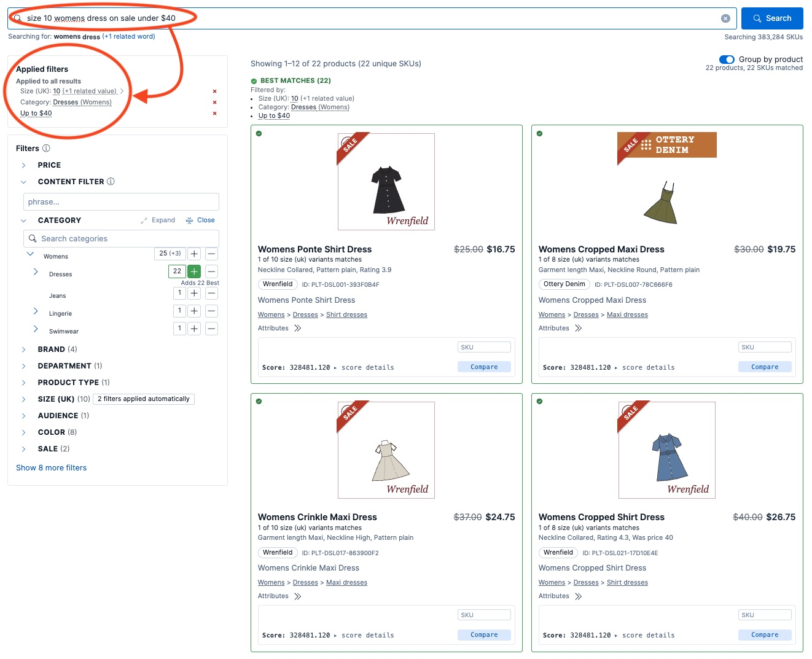

In October, the main repository of an e-commerce search solution that I work on merged 1,652 pull requests (median size 492 changed lines), all of them written by a fleet of about a dozen coding agents that I direct, running in parallel around the clock, seven days a week. That is in the range of the busiest open-source repositories on GitHub: that month Microsoft's VS Code merged 2,549 from 97 people (median 168 lines), and CPython, the main implementation of Python, 1,607 from 184 (median 31 lines). This article is about the rules, tests, CI gates and the control plane (the code that schedules and watches the agents) that keep that rate from turning into chaos, with the measurements behind them and the objections they invite.

## The e-commerce search layer the agents help build

This article is about the AI-enhanced methodology used to create a comprehensive e-commerce solution. Before getting into the methodology, here is a very brief overview of the problem that the solution addresses.

Try this search on a few large e-commerce sites:

> size 10 womens dress on sale under $40

You will likely find that many sites do not get it right. You will often see results that treat the query as a bag of words: size 10 shoes, women's trousers, dresses that are not on sale or cost more than $40, or nothing at all. Few work out that "size 10" is a size, "womens dress" is a category, "on sale" is a promotion and "under $40" is a price limit, and then act on each one.

The solution the agents help build is an e-commerce query interpretation layer, built on top of Elasticsearch, that solves this problem. It reads what the shopper typed and turns it into filters: for the above query, size 10, the category Women's › Dresses and a price of up to $40. The shopper does not have to find and click a single filter. The layer is demonstrated on a [synthetic data catalogue](/data-generation/synthetic-retail-and-industrial-catalog/) of about 380K SKUs across retail and industrial departments.

I have written about its design in [a series of articles on Elastic Search Labs](https://www.elastic.co/search-labs/blog/ecommerce-search-governance-control-plane-architecture); those articles cover what it does.

*The query above on the demo catalogue. The circled filters were applied automatically, from the text the shopper typed.*

## How the search layer is built

The project started as a small, focused piece of code that did one thing well: about 4,000 lines of extremely well-written code, a query rewriter built on Elasticsearch's percolator (which matches a document against stored queries) that [Sidecar](https://sidecar.software/) developed for Elastic under a small, short-term contract (described in [this Search Labs article](https://www.elastic.co/search-labs/blog/elasticsearch-percolator-search-governance)). It has since grown into a full e-commerce search solution, and a large percentage of today's code was written by AI coding agents under my direction. I have worked on it essentially alone since February 2026. Across the project's four repositories (the main one and three smaller ones, described below), the agents merge about 690 pull requests a week, 373 of them in the main repository, the only one the title's figure counts. For comparison, the industry benchmark is about two merged pull requests per engineer per week (see [Scale, compared](#scale-compared)).

The solution itself, backend and frontend, is about 620,000 lines of code. The main repository holds about 3 million, and most of the difference is tests: 2.1 million lines of them. That is not an accident. When agents write the code, the tests are how the system knows it still works: after every change, they check the results against known good results, and CI refuses any change that breaks a test. That is why a large, deterministic test suite is the first requirement of working this way.

It is easy to assume that output like this comes free with the tools: point AI agents at a codebase and the work gets done. The evidence says otherwise. In a controlled trial, experienced developers were 19% slower with AI tools while believing they were faster ([METR](https://arxiv.org/abs/2507.09089)); delivery stability fell as AI adoption rose ([DORA 2024](https://dora.dev/research/2024/dora-report/)); duplicated code grew sharply ([GitClear](https://www.gitclear.com/ai_assistant_code_quality_2025_research)); and an agent deleted a production database during a code freeze ([Replit](https://fortune.com/2025/07/23/ai-coding-tool-replit-wiped-database-called-it-a-catastrophic-failure/)). This project had the same problems at first ([what went wrong here](#initial-growing-pains-when-using-agents-to-develop-code)). Without guardrails, most codebases would collapse under this rate of change.

This article is about how the project evolved into a system that withstands AI development. By "withstands" I mean that with the whole fleet changing it at once, the code keeps working: the tests still check what they claim to, the documentation still describes the code, a bug fixed once stays fixed, and no agent changes what it was not asked to touch. What holds it together is a method: a set of rules, tests, gates and controls that let agents do the work of a large team without the codebase falling apart. The rest of this article describes that method, the measurements behind it, and how each measurement was taken.

## The numbers

### The size of the codebase

The main repository, measured at its current `main` (8 November 2026), in physical lines (blank lines and comments included):

| Part | Lines | Files |
|---|---|---|
| Backend solution code (Python) | 401,000 | 651 |
| Frontend solution code (TypeScript, TSX, CSS) | 216,000 | 767 |
| Backend tests (Python) | 1,627,000 | 3,819 |
| Frontend tests | 485,000 | 1,334 |
| Scripts and tooling (Python and shell) | 286,000 | 574 |
| **Code total** | **about 3.0 million** | |
| Documentation (Markdown) | 243,000 | 2,746 |
| Recorded test data (JSON, CSV) | 2,035,000 | 883 |

Three repositories sit beside it: a synthetic data generator (209,000 lines of code, 72,000 of them tests), a configuration and data repository (about a million lines, mostly data) and the agent-control repository described below (77,000 lines of code and tests).

Of the main repository's code, 70% is tests: 3.4 lines of test for every line of solution code. With AI agents writing the code, that is not overhead. An agent will confidently change code it does not fully understand, and the tests catch it on every pull request, before I look at it. Section 2 below covers how the tests are kept trustworthy.

That is far more than the 4,000-line query rewriter the project started from. It holds the query engine, an interface for merchandisers (the retailer's staff who decide how search ranks and filters products) with editors for its rules, vocabularies and data, the indexing and data-management services, an API for integrating it into an application server, and the demo storefront (the screenshot above). Its size matters less than whether an agent that starts with no memory of earlier work can find the code for a feature and change it correctly, while reading as little as possible. Clean, well-organised and documented code is essential for that. An agent can find its way through well-structured code, so it brings less of it into its context; less context means fewer tokens burned on every call and more efficient work. The file-size caps, the copy-paste check and the code maps described below exist for that.

### The rate of work

| Measure | Value |
|---|---|
| Merged pull requests, main repository, October 2026 | 1,652 (about 373 a week) |
| Merged pull requests, all four repositories, ISO weeks 41–44 (5 October to 1 November) | 2,760 (about 690 a week) |
| Merged pull requests, main repository, April to 8 November 2026 | 6,234: April 195, May 340, June 1,026, July 1,351, August 614, September 547, October 1,652, 1–8 November 509 |
| Lines added / deleted, main repository, October (excluding recorded data) | 1,189,000 / 348,000 |
| Median pull request size, main repository, October | 492 changed lines (the 420 in [the companion article](/ai-tools/agent-fleet-token-efficiency/) is the median over all four repositories, weeks 41–45) |
| Test functions, backend | 27,635 |
| Test cases, frontend | 12,467, plus 144 end-to-end spec files |
| CI | 58 workflows, 136 jobs |
| Merges later reverted | 0.2 to 0.7% |
| Authors, main repository, all time | Pull requests: 6,225 of the 6,295 merged are mine, 36 are from other developers (May to July 2026) and 34 from Dependabot. Commits in `main`: 7,229 of 7,537 are mine, 274 are from other developers (September 2025 to July 2026) and 34 from Dependabot. |

### Scale, compared

Here is October 2026 for my main repository and for some of the best-known open-source repositories on GitHub, measured the same way from the GitHub API on 8 November (merged pull requests; bots excluded from the author count):

| Repository | Merged PRs, October | People authoring them | Median PR size (changed lines) |
|---|---|---|---|
| microsoft/vscode | 2,549 | 97 | 168 |
| python/cpython | 1,607 | 184 | 31 |
| rust-lang/rust | 845 | 234 | 78 |
| kubernetes/kubernetes | 570 | 169 | 132 |
| My main repository | 1,652 | 1 | 492 |

About 700 of CPython's merged PRs are automated backports; the 900 written by people came from 183 of its 184 authors; the other is the backport bot.

The comparison is of merged-PR throughput only, the one number all of these repositories expose. Their pull requests carry products with millions of users and a release process. My pull requests are opened by agents under my GitHub account, so my author count is the number of people directing the work. Their author counts include occasional outside contributors, so their core teams are smaller.

Against the most widely published productivity benchmark, about 2 merged PRs per engineer per week ([Graphite](https://graphite.dev/research) puts the median active developer there, and [LinearB's benchmarks](https://linearb.io/engineering-benchmarks/) start the elite tier at above 2.0), the main repository's 373 a week is the output of about 186 engineers. The benchmark's [median PR is 47 changed lines](https://graphite.dev/research/median-pr_size); mine in October is 492. As a thought exercise, normalising by size would raise the ratio further: by changed lines, 373 PRs of 492 lines a week matches about 1,950 engineers merging two 47-line PRs each (not a realistic figure, since it multiplies medians, and changed lines are a poor measure of work, as the objections below concede).

## Fair objections

**"Pull requests are a vanity metric. Split the work finer and the count goes up."** True in general, which is why the PR size matters. These PRs are ten times the industry median, not smaller. The companion article on token use makes the same point from the other side: tokens per changed line, not per PR, is the honest efficiency figure.

**"Lines of code are meaningless."** Agreed. That is why the headline uses merged PRs, each of which passed review and CI, and the line counts are only there to show scale and how much of it is tests.

**"70% of it is tests. That's padding."** It is the opposite. Tests are what let one person trust code they did not type. Every test runs on recorded data in the repository, so it gives the same answer every time. Without that, the rate above would be a rate of producing bugs.

**"Then the quality must be bad."** The solution is already live with retailers. The quality evidence I measure on every change is this: 0.2 to 0.7% of merges are later reverted, every PR is reviewed by a separate agent whose job is to find what is wrong with it, and every PR must pass 136 CI jobs before it merges. A measure of how many real shopper queries the layer interprets correctly, tracked over time, is the one I do not have yet, and the next thing to build. The weak spot is rework, not breakage: about one fix round per merged PR (the reviewer blocks the PR, an agent fixes what it found, and the PR is reviewed again), which I measure and am working to reduce.

**"An engineer does more than merge PRs: design, review, triage, operations."** So does this system. Review is done by agents. Triage is done by agents: each new issue is labelled with a severity, a lane (the area of the work) and an audience (who the change is for: shoppers, merchandisers, integrators or developers). Operations are done by agents: a watchdog checks the fleet every 15 minutes. What remains for me is the part that cannot be delegated: what the solution should do, and judging whether it does it.

## Why it does not fall apart

Give a dozen AI agents write access to a repository and the default outcome is chaos: duplicated helpers, tests that test nothing, documentation that describes code that no longer exists, fixes that silence a failure instead of curing it, and agents that wander off and rewrite things nobody asked them to touch. Every one of those happened here. Each one now has a rule, and each rule has a check that enforces it.

### Initial growing pains when using agents to develop code

In the early months there were few written rules and few deterministic tests, and the agents did exactly what one would fear. The failures fell into a few recurring patterns:

- **Tests that passed without testing anything.** Asked for tests, an agent would sometimes write ones that checked their own setup instead of the code: a copy of the logic inside the test, or an assertion that could never fail. Everything was green, and nothing was verified.
- **Tests that skipped instead of failing.** When something a test needed was missing, the test quietly skipped itself, so a broken feature looked like a passing run.
- **Fake data that did not match reality.** Tests ran against hand-written stand-ins for the responses of the real system. Where the stand-in differed from what the system actually sent, the tests passed while the real thing was broken, and green CI kept saying that each attempted fix worked.
- **Silent guesses instead of errors.** Where a specification was incomplete, an agent filled the gap with a guess, such as a default value or a leftover formula, rather than stopping. The code ran and did something plausible, just not what was asked. My ruling, quoted in the issue: "I do not want implicit behavior, or escape hatches that allow lazy or incomplete specifications to pass."
- **Warnings switched off rather than fixed.** An agent that hit a type-checker or linter error could silence it on that one line, and the silenced line was sometimes exactly where the bug was.
- **Reaching outside the task.** An agent cleaning up after itself could delete files it had not created (once, 110 of them), or run a command in the wrong directory and change a checkout it had no business touching.
- **Too much guidance at once.** Each lesson went into the contributor guide, and at first every agent read the whole guide before it started. As the guide grew, agents spent their context, and their attention, on rules unrelated to their task, and missed the one that mattered: the guidance meant to prevent mistakes became a cause of them.

### How the system went from painful to self-improving

The workflow evolved from those failures, and it still improves the same way: a failure does not just get a fix, it gets a change to the system, so that the error, and its whole class of errors, cannot happen again. Each failure above followed the same path. The agent fixed the instance. The lesson went into the written guidance, with the issue number, so the next agent could read what went wrong. Then the guidance became a test or a CI check, because a written rule is followed most of the time and a check is followed every time. Tests now run on recorded responses from the real system instead of hand-written stand-ins; CI refuses a test that skips itself silently; a missing setting is an error, not a guess; a weekly scan looks for silenced warnings already in the code; and hooks (scripts Claude Code runs before each tool call, which can refuse it) refuse any write outside an agent's own copy of the repository. The guide itself was split into topic files behind a small root guide whose size is capped, so an agent reads only the part its task needs. The sections below are where those checks ended up.

#### 1. The rules are written down, and every rule has its incident

The rules come in three layers: a root guide of about 2 KB that is loaded into every model call; `CONTRIBUTING.md`, the contract every agent works under, 350 lines; and 66 topic files (about 36,000 lines) that `CONTRIBUTING.md` points into. It covers architecture boundaries, naming, error handling, testing, documentation and review.

Three things make it work rather than become a wall of text nobody reads:

- **An agent reads only the part it needs.** The rules are split into topic files so that an agent changing a test reads the testing rules, instead of reading tens of thousands of lines of instructions to find the relevant one. Every line an agent reads costs tokens and competes for its attention.
- **Each rule cites the incident that produced it**, by issue number. An agent tempted to break a rule can read exactly what went wrong last time.
- **The file loaded into every agent call is capped in size.** The root guide that every agent reads on every model call is held to about 2 KB by a CI check (the cap can only go down). Everything else is a pointer. A guide that grows without limit gets skimmed; one that cannot grow stays read.

The same idea applies to the code and the documentation. A human engineer builds up a memory of a codebase; an agent starts from nothing every time and has to read code into its context to understand it. The better structured the code, the less it has to read: smaller context, fewer tokens and better attention on the change itself. Each package has a code map, generated from its module docstrings: one line per module, saying what it does, its main public names and the routes it serves. An agent looking for where to change something searches the map instead of reading the code to find out. The documentation is split the same way, by topic and by reader, and its claims are tested against the code (below), so an agent can trust the page it opens instead of checking it against the source.

Decisions live in the repository, not in chat. When I rule on how something should behave, the ruling is quoted verbatim in the issue, with its date, and the work traces back to it. An agent never has to guess what I meant three weeks ago.

#### 2. Deterministic tests, on recorded data

The rule is simple: **tests run on fixed data in the repository.** When a behaviour depends on a live system, the agent records the live response as a fixture and tests against that. No test reaches a shared cluster, so a test that passed yesterday passes today for the same code.

That is what makes 27,635 backend test functions and 12,467 frontend test cases an asset instead of a flaky-test tax. When a test fails, the code changed.

Tests are also held to account:

- A test module is named by what it pins (`test_facet_counts_are_floors.py`), and a script refuses a new one that is not.
- Documentation claims are tested against the code. A "claim test" compares a docs page with what the code does, and is proven to bite by planting false sentences and checking that it catches them.
- A flaky test is a severity-1 bug, not something to retry.

#### 3. CI is the boss, and the gates are tested too

136 CI jobs run on every pull request. Some are ordinary (unit tests, type checks, end-to-end tests). Many exist because an agent once did something a human reviewer would have caught by instinct:

- **File-size caps.** No source file may grow past 1,750 lines without a stated exception. Agents love to keep appending to one file.
- **Audit greps.** About two dozen patterns, each tied to a failure class that slipped past review more than once, run on every diff.
- **Change obligations.** "If you touch X you also owe Y" is enforced by a script, not remembered.
- **A copy-paste check.** A block of code copied verbatim from elsewhere in the repository blocks the merge. Agents copy where they should reuse.
- **An efficiency ratchet.** A daily run reads efficiency figures (merge-queue evictions and time, review rounds, the slowest CI job, the size of the guidance agents read) and fails when one gets worse than its recorded baseline. The baselines may only improve.
- **Process guards.** A process improvement ships with a deterministic check that fails when the improvement regresses.

The gates themselves get attacked. On one day, four separate reviews each found a new gate blind to a different spelling of the thing it was meant to catch (`./tests/` instead of `tests/`, a folded YAML value, a shell array). In one case 10 of 12 deliberately planted evasions got through. Since then, every new gate is run against a standard kit of evasions before review. An agent will find the gap in your gate. It is not malicious; it is optimising. The gate has to be built for that.

#### 4. Every change is reviewed by an agent whose job is to say no

Every substantial change is reviewed twice against an adversarial review checklist: once by its author before opening the PR, and once by an independent reviewer agent before merging. The reviewer posts a verdict. Nothing merges without a verdict at the reviewed commit and green CI.

Review agents are separate from implementing agents, with their own instructions and a narrower set of tools. The author's confidence carries no weight.

#### 5. A control plane for the agents, under version control

Since late October, the agents themselves are run by code, not by me typing prompts. That code lives in its own repository, separate from the solution, so process changes never tangle with changes to the solution:

- **An allocator** keeps a fixed number of agents running at once (the slots) on a cloud VM, drawing work from a single queue. Work is drawn by priority and by weighted lanes (areas of the solution, CI throughput, reviews of old PRs). Urgent work goes to the front of the queue, never around it.
- **Lanes, so features do not crowd out everything else.** Left alone, a fleet works on whatever was asked for last, and that is almost always a feature. So every issue belongs to a lane: the core solution, the demo, developer efficiency, CI throughput, runtime performance, data generation, the companion repositories, process automation. Each lane has a weight, and the allocator draws new work from the lanes in proportion, so performance, CI and tooling work keeps getting agents in a week full of feature requests. Open PRs get a fixed share of their own (two thirds of the slots), so new work never starves work already in flight. A lane with nothing ready lends its slots to the others, and each lane's actual share is reported against its target, so a starved lane shows up instead of quietly falling behind.

  As an example, these are the weights today. Each is a share of the new issues the allocator picks; urgent work and the open-PR share come before them, and two rows are classes that cut across lanes (bugs, and issues that have stalled). For the week before a presentation the demo weight went up to 150, then back to 60: a temporary priority is a different table, not a different mechanism.

  | Lane | Weight | Share of new picks |
  |---|---:|---:|
  | Demo | 60 | 25% |
  | The control plane itself | 50 | 21% |
  | Developer efficiency | 20 | 8% |
  | Data generation | 20 | 8% |
  | Bugs, in any lane | 20 | 8% |
  | CI throughput | 15 | 6% |
  | Runtime performance | 15 | 6% |
  | Companion repositories | 15 | 6% |
  | Core solution | 10 | 4% |
  | Process automation | 6 | 3% |
  | Integration | 6 | 3% |
  | Stalled issues | 3 | 1% |

- **A watchdog** runs every 15 minutes with no AI involved. It checks for stalls, failing (red) CI on `main`, PRs that have stopped moving, and jobs that failed.
- **An oversight loop** checks the watchdog: each run records whether something was caught by a trigger, found clean, or missed. A miss files its own fix.
- **Stop the line.** A red `main` or a stuck PR is fixed before new work starts, with a deadline after which it escalates. It is *jidoka* from the [Toyota Production System](https://global.toyota/en/company/vision-and-philosophy/production-system/): stop the line at the defect, because every agent after it will build on the broken base.
- **One folder per agent.** Every agent develops in its own clone of the repository, on its own branch, so a dozen agents work at once without touching each other's files. The checkout I demo from is never written to by an agent: hooks refuse any write outside the agent's own clone.

The control plane has been redesigned twice, the second time from scratch. The first two versions grew by patching: a watcher here, a re-send there. When it became clear that patches were adding failure modes faster than they removed them, I stopped patching and had it rewritten from scratch as a minimal allocator. That is the rule now: a stall gets fixed today and gets a deterministic rule with a test, so it cannot recur.

#### 6. Issues are written so an agent can finish them

Every issue title says what should happen and what happens now: "X should do Y; currently it does Z." The body states the consequence, the trigger, who is affected, and a "Done when" list that traces back to the request it came from. An agent picks up an issue cold, with no conversation history, and knows when it is finished.

#### 7. What I actually do

I decide what the solution should do. I test it the way a customer would, and when something is wrong I say so in plain words, often with a screenshot. Those words become an issue with my sentence quoted in it. I make the rulings that the rules cannot: when two good designs conflict, which one wins.

I also design the system described above, and every time it fails, I change it so that failure cannot happen again. That is the job now. It is closer to running an engineering organisation than to being an engineer in one, except that the organisation is software.

## What it costs, and what still breaks

None of this is free. A fleet of agents uses a lot of tokens, and at the start a week's token budget did not last the week. Six changes later, each changed line of code takes less than a third of the tokens it did (a 3.3x drop; about 2.5x when each kind of token is weighted by its price, because the cheap cached reads fell most), and the agents merge 4.4 times as many pull requests a week on about the same spend. Rework is about a fifth of agent tokens, and those figures include it. [The companion article on token use](/ai-tools/agent-fleet-token-efficiency/) shows how: where the tokens went, how I measured it from the transcripts already on disk, and what each change brought. A small starting point extracted from the private setup, the two hooks that did the most and the measuring script, is public in [agent-fleet-kit](https://github.com/alexander-marquardt/agent-fleet-kit).

What still breaks: rework. About one fix round per merged PR is too many, and it is where the next round of improvements goes. Agents still occasionally solve the wrong problem confidently, which is why each issue quotes my ruling word for word, and the agent reviews are adversarial.

## Why this should matter to anyone running engineering

The bottleneck is no longer typing code. It is specifying what should be built, checking that it was built correctly, and keeping a codebase coherent while it changes at hundreds of pull requests a week. An assistant in each engineer's editor speeds up typing. The step change comes from building the system around the agents: written rules with their reasons, deterministic tests, CI that enforces what reviewers used to remember, independent review, and a control plane that runs the fleet.

None of the pieces is exotic. Each one is something a good engineering team already knows it should do, applied without exception because agents, unlike people, will not fill the gaps with judgement. With them in place, one developer directs, on this project, a volume of merged work that is usually the output of a large team, and the numbers above show how that was measured.
