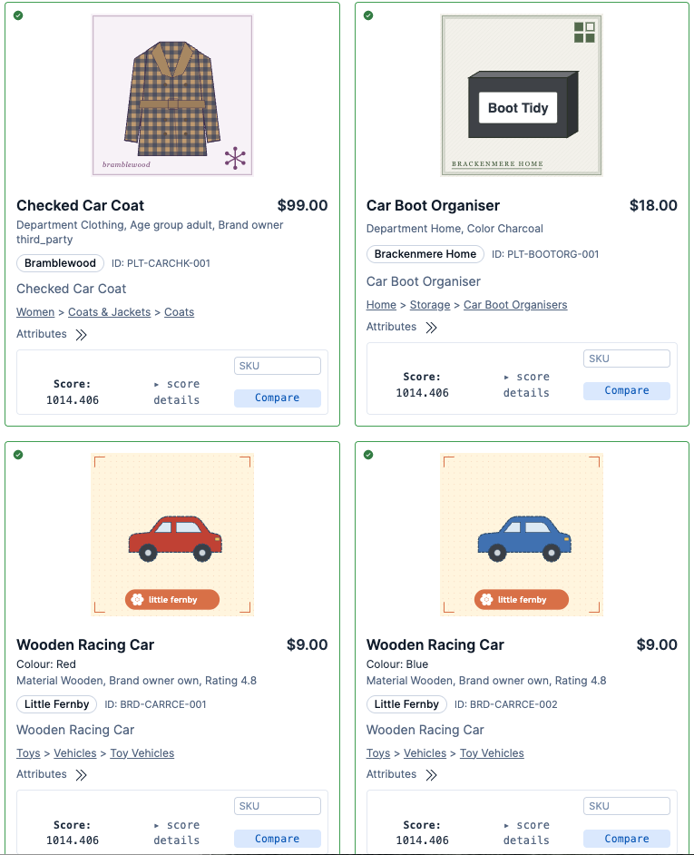
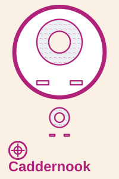
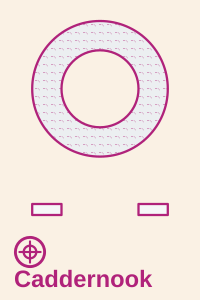
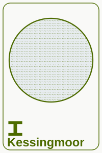

## Introduction

In two earlier articles I described how I turn open data into demo-ready e-commerce catalogs: [groceries from Open Food Facts](/data-generation/open-food-facts-grocery-demo-data/) and [electronics from Icecat](/data-generation/icecat-electronics-demo-data/). Both work because there is an open source with real products, real images and a licence that is clear enough to build on.

For industrial supply — end mills, drills, taps, socket cap screws, hex bolts, washers — I could not find an equivalent. The real catalogs in this vertical are the distributors' own product data, and none of it can be redistributed as a demo asset. So instead of harvesting a catalog, I wrote a generator for one: [**synthetic-ecommerce-data**](https://github.com/alexander-marquardt/synthetic-ecommerce-data) (it was called `synthetic-industrial-products` when I first wrote this article, and was renamed so that one generator can build more than one vertical).

*Updated 2026-10-18. The generator has been renamed to `synthetic-ecommerce-data` and also builds a retail catalog, described in [Beyond industrial supply](#beyond-industrial-supply). The figures in this article are from the default industrial build at that date: 11,765 SKUs, with a drawing for every one. Since the first version the industrial catalog has grown from 12 product types to 79, its drawings now carry a small brand plate, and prices are drawn from a measured price census. The `sip-generate` command is now `ecom-generate`; the old name still works for one release cycle.*

**Every product it produces is synthetic.** No record describes a real product offered by any retailer, the brands are invented, and no retailer's catalog content is redistributed. What *is* taken from the real world is the shape of the domain: which attribute names the industry uses, which dimension combinations are physically real, how titles are constructed, and how often real records are inconsistent.

## Why generate an industrial catalog at all?

A synthetic catalog is usually the thing you settle for when you cannot get real data, and it tends to make demos less convincing: every field populated, every value well-formed, every title built from the same template. That is not what a real catalog looks like, and it does not exercise a search engine the way a real one does.

Industrial supply has one property in particular that is hard to fake convincingly: **attribute-role ambiguity**. The same dimension token legitimately appears in different roles on the same kind of product. A `3/8"` is the cutting diameter on one end mill and the shank diameter on another. A shopper searching for `3/8 end mill` wants the first and not the second, but full-text search matches both.

On the generated catalog, that is measurable. Of the 212 end mills that carry a `3/8"` value anywhere, 114 have a 3/8" cutting diameter, while 31 carry it as their shank diameter and have a different cutting diameter — a full-text match on the token returns all of them, and only a structured filter on the right attribute separates the two. Demonstrating that a search engine handles this correctly requires a catalog whose dimensions are internally coherent and whose collisions happen at a realistic rate, which is exactly what a naive generator does not give you.

## What it generates

With the default configuration, the generator produces **6,501 product lines and 11,765 SKUs across 79 product types**, from 45 invented brands. Thirty-six of those types are the catalog's *depth*: from 25 to 679 lines each, with realistic attribute schemas, messiness and drawings. The other 43 are *breadth*: one line of one to three SKUs per category, there so that a query like `1/2 ball` has more of the category tree to land in than end mills, hex keys and bearings, and marked on every record (`spec_quality: "fast_and_cheap"`) so they can be told apart and removed.

| product type | product lines | SKUs |
| :--- | ---: | ---: |
| `bearing_radial_ball` | 679 | 1,182 |
| `wheel_depressed_center` | 679 | 1,175 |
| `nut_hex` | 662 | 1,264 |
| `hex_key` | 630 | 1,120 |
| `end_mill_square` | 498 | 936 |
| `screw_socket_head` | 310 | 598 |
| `end_mill_ball` | 286 | 524 |
| `drill_jobber` | 285 | 520 |
| `set_screws_hex_socket` | 260 | 485 |
| `lock_nuts_nylon_insert` | 256 | 469 |
| `bolt_hex` | 235 | 451 |
| `screw_flat_head` | 181 | 327 |
| `tap_spiral_point` | 179 | 329 |
| `washer_flat` | 135 | 225 |
| `screw_button_head` | 130 | 263 |
| `abrasive_flap_disc` | 129 | 232 |
| `screw_low_head` | 103 | 189 |
| `hammer_ball_pein` | 92 | 162 |
| `shackles` | 74 | 132 |
| `kit_assortment` | 59 | 59 |
| `roller_chain_sprockets` | 54 | 102 |
| `roller_chain_links` | 52 | 94 |
| `pillow_block_bearings` | 43 | 90 |
| `turnbuckles` | 42 | 87 |
| `key_stock` | 42 | 70 |
| `roller_chain` | 40 | 68 |
| `retaining_rings_external` | 39 | 82 |
| `cotter_pins` | 39 | 67 |
| `o_rings` | 38 | 66 |
| `dowel_pins` | 36 | 60 |
| `hammer_dead_blow` | 31 | 44 |
| `hammer_claw` | 30 | 42 |
| `hammer_rubber_mallet` | 29 | 41 |
| `hammer_framing` | 28 | 50 |
| `hammer_sledge` | 28 | 47 |
| `hammer_club` | 25 | 38 |
| 43 breadth categories (ball stock, threaded rod, hose clamps, ball valves, …) | 43 | 75 |

Across those types the catalog publishes **123 distinct attribute names**, with a category path for every product (for example `Milling > End Mills > Square End Mills`).

### Product lines and SKUs

The data model follows how industrial catalogs are actually organised. **A parent is one manufacturer's product line, and its children are the individual purchasable SKUs.** Attributes that are constant across the line (brand, series, material, coating, flute count, end style) live on the parent; the ones that vary (cutting diameter, length of cut, overall length, shank diameter, price, stock) live on each SKU. Lines are never grouped across brands: two manufacturers' tools at the same nominal geometry are different products.

Attributes are key-value pairs, and a measurement is split into its magnitude, its unit and a canonical number in the same entry:

```json
{"key": "milling_dia", "name": "Milling Dia.", "value": "3/8", "unit_code": "INH", "value_canonical": 9.525}
```

`value` is the bare magnitude, `unit_code` is the only place the unit lives (a UN/CEFACT code: `INH` for inches, `MMT` for millimetres, `C62` for a count), and `value_canonical` is the magnitude in the kind's canonical unit, here millimetres, so one range filter works across inch and metric spellings. The split is parsed *back out of* the published string rather than computed from the generator's own number, so the two can never disagree. The published spelling (`3/8"`) is kept in the flat shape's `facets`. An attribute that is not a measurement has no `unit_code` or `value_canonical` at all, and neither does a measurement whose value is deliberately malformed.

### Two shapes from one catalog

A single build writes the same generated products in two shapes, so any difference in what they return is a property of the shape rather than of the data:

| file | shape |
| :--- | :--- |
| `nested.jsonl` | one document per product line, with its SKUs and key-value attributes nested |
| `flat.jsonl` | one document per SKU, with attributes denormalised, plus sanitised per-attribute `facets` (the published spelling) and `facets_num` (the number) fields |
| `images.jsonl` | one row per SKU drawing: its path, its URL, the sha256 of its bytes and their count, and whether its geometry came from the record (`record`, `partial` or `nominal`) |
| `render.jsonl` | the original twelve types' SKUs, in the shape an older, dimensioned renderer reads; the catalog's own drawings do not use it |
| `stats.json` | what was generated, measured against the statistics it reproduces |

Elasticsearch mappings for both shapes (`mapping.flat.json`, `mapping.nested.json`) ship alongside them. Here is one SKU from the flat shape, trimmed to its interesting fields:

```json
{
  "sku": "7038390581",
  "product_id": "HOL-K701-7038-0001",
  "product_type": "end_mill_square",
  "title": "High Speed Steel Square End Mill, 1/16\", HSS, 4 FL, SGL Sq End",
  "description": "High Speed Steel Square End Mill, 1/16\", HSS, 4 FL, SGL Sq End - 1/8\" Shank Dia., 3/16\" Length of Cut, 0.2149\" Neck Length, Hollisdane K701. Listed in the Hollisdane K701 family. For slotting, profiling and facing on milling machines.",
  "parent_title": "Hollisdane K701 -- High Speed Steel Square End Mill",
  "brand": "Hollisdane",
  "series": "K701",
  "category_path": ["Milling", "End Mills", "Square End Mills"],
  "dimension_provenance": "generated from the conventional tool series; no standard fixes these values",
  "price_usd": 12.0,
  "stock": 99,
  "pricing_unit": "Each",
  "order_multiple": 1,
  "image_url": "/images/industrial/end_mill_square/HOL-K701-7038-0001/7038390581.svg",
  "attributes": [
    {"key": "end_mill_style", "name": "End Mill Style", "value": "Square"},
    {"key": "material", "name": "Material", "value": "High Speed Steel"},
    {"key": "number_of_flutes", "name": "Number of Flutes", "value": "4", "unit_code": "C62", "value_canonical": 4.0},
    {"key": "milling_dia", "name": "Milling Dia.", "value": "1/16", "unit_code": "INH", "value_canonical": 1.5875},
    {"key": "shank_dia", "name": "Shank Dia.", "value": "1/8", "unit_code": "INH", "value_canonical": 3.175},
    {"key": "length_of_cut", "name": "Length of Cut", "value": "3/16", "unit_code": "INH", "value_canonical": 4.7625}
  ],
  "facets": {"milling_dia": ["1/16\""], "shank_dia": ["1/8\""], "length_of_cut": ["3/16\""]},
  "facets_num": {"milling_dia": 0.0625, "shank_dia": 0.125, "length_of_cut": 0.1875}
}
```

The `facets` object exists because `Milling Dia.` cannot be an Elasticsearch field name (the trailing dot makes it an invalid path), so each attribute gets a sanitised key of its own.

### Why the flat shape is not enough

The flat shape is easy to load, but it has a well-known weakness that the catalog makes visible. In the flat document the `attributes` array is a plain object, so `name` and `value` become two independent multi-valued fields and the pairing between them is lost. On the committed catalog, filtering for *name = `Shank Dia.` AND value = `3/8"`* matches **217** documents, but only **125** of them actually have a 3/8" shank; the other 92 carry a 3/8" that belongs to some other attribute.

That is why the flat shape also carries the per-attribute `facets.*` keys, where the pairing cannot come apart, and why the nested shape exists at all: with nested documents and `reverse_nested`, "how many *products* have this value" becomes answerable.

## Beyond industrial supply

When I first wrote this article the generator built only the industrial catalog. It now also builds a retail one, which is why it was renamed. The retail catalog is still a prototype that lives beside the industrial generator in the same repository (`prototypes/retail_drawings/`), and it follows the same rules: no real retailer's content, deterministic output, and a generated drawing for every product. A retail record is one product per style, with its colours and sizes as nested SKUs, written in the same output standard as the industrial catalog. Its departments are Clothing, Footwear, Lingerie & Nightwear, Home, Garden, Beauty, Toys, Gifts, Cleaning & Janitorial, and Food & Drink. The food SKUs carry an invented ingredient list and allergen and dietary claims that agree with each other.

At its largest, the retail build is **15,079 styles, 152,732 SKUs and 22,709 images**. These are measured totals from `golden-retail/stats.json` in the repository, not typed into the documentation. The retail drawings are keyed per style and colourway, not per SKU: every size of one colour shares one picture, drawn in that colour. The retail catalog also plants ordinary products that win a query on text alone, so that a demo can show what a ranking policy fixes.

Brands are invented, with one narrow exception: a few well-known sportswear and consumer-electronics names appear as plain text so that a shopper who types one finds something. No retail drawing carries a logo.

Retail is not built by `ecom-generate`; the industrial catalog described in the rest of this article still is. The retail build has its own scripts, run from a clone of the repository:

```sh
uv run python prototypes/retail_drawings/scale.py --skus 20000 --out out/retail.jsonl --flat out/retail.flat.jsonl
uv run python prototypes/retail_drawings/image_release.py --skus 20000 --out out/retail-images --archive out/retail-images.tar.gz
```

`--skus` is the size knob: the build stops at the first style past the target, so `--skus 20000` writes a little over 20,000 SKUs, and a smaller build is a prefix of a larger one. The largest build is about 150,000 SKUs. `scale.py` writes the nested documents and, with `--flat`, one flat document per SKU; `image_release.py` renders and packages the images those documents point at.

## Where the realism comes from

### Observed statistics, generated products

The **schema** and the **statistical distributions** are derived from observing publicly archived catalog pages of a real industrial distributor: attribute names, which dimension combinations occur together, how often roles collide, how titles are built, and how often records contradict themselves. Those are facts about the domain. The **products** are generated; they are not real records with the names changed.

That distinction is enforced rather than asserted. The repository ships *hashes* of the reference records' full attribute tuples (never the records themselves), and the test suite checks that no generated product matches any of them. The comparison is over the whole tuple rather than field by field, because agreeing with a published standard on one dimension is not copying — every real `#10` flat head cap screw has the same head diameter — whereas reproducing a complete record would be.

### Dimensions: standards for fasteners, conventional series for cutting tools

The two halves of the catalog get their dimensions differently, and every product line says which:

- **Fasteners** are **standards-derived**. Each line carries the standard its dimensions came from (`ISO 4762`, `ISO 7089`, `DIN 933`, `ASME B18.3` and so on). The values were extracted from open-source CAD fastener libraries — primarily the [FreeCAD Fasteners workbench](https://github.com/shaise/FreeCAD_FastenersWB), with [BOLTS](https://github.com/boltsparts/boltsparts) as corroboration — rather than transcribed by hand, and only the sizes the catalog offers were taken. A size the sources do not carry is absent rather than invented.
- **Cutting tools** are **generated** from the conventional size series. There is no open dimensional source for end mills, so nothing on those lines claims a standard, and the provenance field says so in words (you can see it in the record above).

The asymmetry is deliberate: a cap screw's head is fixed by a published standard and a catalog that disagrees with it is wrong, while an end mill's length of cut is a manufacturer's choice within a conventional range.

### Realistic messiness

Real catalogs are messy, and a search demo on a perfectly clean catalog proves very little. The generator reproduces the defect classes found in the reference data rather than smoothing them away — inconsistent unit formatting within a record, ragged attribute coverage, unlabelled dimension tokens in titles, and occasional internally impossible dimensions. Each rate is reproduced against its own denominator (the records that actually carry the attributes involved), and `ecom-generate report` prints what was achieved beside the target:

| measured property | target | achieved |
| :--- | ---: | ---: |
| shank diameter == cutting diameter | 0.6489 | 0.6863 |
| length of cut > overall length | 0.0829 | 0.0784 |
| an angle attribute carries a length unit | 0 (the corpus: 0.0469) | 0 |
| declared measurement system contradicts the value's units | 0.0323 | 0.0304 |
| unit mixing within one record | 0.0222 | 0.0149 |
| title dimension token carries no label | 0.4667 | 0.4678 |
| title dimension token is not the primary dimension | 0.1714 | 0.1059 |
| attributes per record (mean) | 13.12 | 12.17 |

The angle row is deliberate: the reference data has angles written as lengths about one time in twenty, but the generator no longer reproduces that, because a real retailer would fix such a row and a facet that offers `2"` beside `118` degrees is a bug, not realism. `ecom-generate report` also checks prices against the statistics of a measured price census, per product type, with a tolerance band for each.

Even the attribute *names* are inconsistent in the way real data is. The measurement-system attribute appears under three different names (`Dimension Type`, `Measurement System` and `System of Measurement`), and the flat shape deliberately keeps them as three separate keys: folding them together at generation time would hide exactly the problem a search layer has to solve.

Titles vary the same way. These are nine square end mills, one SKU from each of nine different product lines:

```text
High Speed Steel Square End Mill, 1/16", HSS, 4 FL, SGL Sq End
End Mill, 5/16" Milling Dia., 15/16" Cut L, Solid Carbide, AlTiN, 2 FL
High Speed Steel Square End Mill, 3mm, HSS, TiAlN, 2 Flutes, SGL Sq End
Industrial Solid Carbide Square End Mill, 4mm D, Solid Carbide, 4 FL, SGL Sq End
Pellanor End Mill, 6mm Milling Dia, Co, TiCN, 4 Flutes, SGL Sq End
Iron Heron Cobalt Square End Mill, 2.50mm Milling Dia., Cobalt, AlTiN, 2 FL
Lark & Lathe Cobalt Square End Mill, 3/8" dia., 1-1/2" Cut L, Cobalt, TiAlN, 6 Flutes
Industrial End Mill, 3mm dia., 38mm Lg, High Speed Steel, Bright, 2 Flutes
End Mill, 10mm Milling Dia.,Cobalt, TiAlN, 4 Fl
```

The diameter is labelled `Milling Dia.`, `Milling Dia`, `dia.`, `D`, or not at all; the length of cut is `Cut L` or `Lg`; the material is `High Speed Steel` or `HSS`, `Cobalt` or `Co`; the flute count is `Fl`, `FL` or `Flutes`; the brand's name appears in some titles and not others; and the spacing is not always the same. All of that is realistic, and all of it is something a query parser has to cope with. Within one product line the titles typically share a template and differ in the value that tells the SKUs apart, as they do in a real catalog's series.

The messiness is bounded by a few rules that keep the catalog usable. Every title names a value that is unique to that SKU within its line, so no two SKUs in a line share a title or a description. The description opens with the title verbatim and then continues with the remaining distinguishing attributes, which is the convention real listings follow: the title tells SKUs apart at a glance, the description while scanning, and the attribute block precisely.

## Generated technical drawings

A demo catalog without images is not a demo catalog, and industrial product photography is exactly the content that cannot be borrowed. Photographs of a generated product cannot exist, since the product does not, and a picture taken from somewhere else would show a real product the record does not describe. So the generator also draws the pictures, and it draws them from the records.



*Search results for "car" in the demo search UI. Every picture is a generated drawing.*

**The pictures are drawn by code.** Each one is written straight to SVG, from the SKU's own attributes, by a small writer in the generator: no image model and no photographs. A drawing is deterministic, so the same record always gives the same bytes, and it costs nothing per variant. It is parameterised by product type, brand house style and attributes such as colour, pattern and size. It is also fast. On an Apple M3 Pro laptop I timed the generator's own drawing step over the SKUs of the default build: roughly 7,000 drawings a second on one core, or 0.14 ms each (three runs, between 6,900 and 7,400 a second). That times drawing only, with the records already loaded. Rebuilding all 11,765 drawings from the committed catalog, writing the files and the archive and checking every drawing's digest against the catalog, took about five seconds on a Linux cloud VM.

**Every SKU has a drawing of its own, drawn from that SKU's own published values.** The default build has 11,765 SKUs and 11,765 drawings. Two lengths of one socket head cap screw therefore look different, and a grouped product page can switch the picture when a shopper picks a different size. That is a deliberate departure from real distributor catalogs, which mostly show one photograph for a whole series. A generated drawing costs nothing per size, so there is no reason to copy that habit.

| M10 × 35 mm | M10 × 55 mm | M4 washer | M20 washer |
| :---: | :---: | :---: | :---: |
|  |  |  |  |

The first two are SKUs of one product line, a stainless M10 socket head cap screw at two lengths; the second two are SKUs of one stainless flat-washer line. Under each figure is the brand plate, described below. Every drawing in this article is the generator's output, byte for byte, and each is under 4 KB of SVG.

### What "parameterized" means here

Each drawing is a pure function of three things: the product type, the brand, and the SKU's published attributes. Nothing is styled from an identifier and nothing is random, so the same record always produces the same bytes. A drawing is built in three steps:

1. **Attributes to geometry.** Every drawn product type has a figure function that reads the record's published values (thread size and length for a screw; diameter, length of cut and flute count for an end mill; bore, outside diameter and closure type for a bearing) and builds the part as shapes measured in inches. It reads those values through the same parsing code as the rest of the generator, so the drawing and the data cannot disagree about what a record says.
2. **Geometry to sheet.** The part is placed on a 200 × 300 sheet at its product type's scale, in the 236 units above the brand's plate (the strip at the foot of the sheet).
3. **Sheet to SVG.** A small SVG writer in the generator itself, about a hundred lines of plain Python, writes out the paths, circles and fills. No drawing or plotting library is involved. An earlier version of the generator drew with matplotlib, but its SVG carries metadata and glyph definitions that these drawings do not need. The hand-written output averages about 2.5 KB per drawing: the 11,765 drawings come to about 30 MB, and the largest is under 8 KB.

The specifications show up visually rather than as text. A longer length of cut is drawn longer and a finer thread with more crests. A flat head is drawn as a cone and a button head as a dome. A sealed bearing is drawn closed, while an open one shows its balls. The other visual channels map to the record in the same way:

| channel | driven by |
| :--- | :--- |
| shape and proportions | the SKU's own dimensions |
| flutes and thread crests | the published flute count and thread pitch |
| fill tint | the finish (TiAlN is violet-grey, TiN gold, black oxide dark), otherwise the bare material's colour |
| section hatch | the material, as engineering drawings already denote it |
| outline ink, paper tint, frame | the brand's house style |
| brand plate | the brand's mark and name |

Each of the 45 brands owns one house style (twelve inks, six paper tints and four frames, with no two brands sharing an ink and a frame) and one mark, which sits with the brand's name in the plate under the figure. A brand's drawings look like a set and two brands' drawings look different, which is the role a manufacturer's photography style plays in a real catalog. Rotation, tilt and random decoration were considered and rejected because they correspond to no product property. A reader who sees two tools drawn differently concludes the difference is real, and with the drawing driven by the record, that conclusion is correct.

The default build has 11,366 distinct drawings for its 11,765 SKUs. Every repeat is the same brand drawing the same values, usually in different product lines: for example, the same 607 double-shielded chrome-steel bearing listed three times. An identical picture is the right answer there.

### One drawing, in code

This is the complete figure function for a flat washer:

```python
def washer(record: Record) -> Drawn:
    geom, source = _read(record, washer_geom.geometry_from_record, {}, WASHER_NOMINAL)
    od, i_d, t = geom.outside_d.inches, geom.inside_d.inches, geom.thickness.inches
    fig = Figure(size_in=od)
    fig.disc((0.0, 0.0), od / 2)
    fig.disc((0.0, 0.0), i_d / 2, "hole")
    edge = od / 2 + 0.35 * od
    fig.rect(-od / 2, edge, -i_d / 2, edge + t, "plain")
    fig.rect(i_d / 2, edge, od / 2, edge + t, "plain")
    return Drawn(fig, source)
```

`_read` takes the outside diameter, the inside diameter and the thickness from the record. It falls back to a nominal proportion only for a value that is missing or inconsistent, and it reports which happened as `source`. The function draws the face as two discs and the edge view as two bars; everything else (scale, colour, hatch, frame, brand plate, lens) comes from the shared layers. The face of the M20 washer above comes out as these elements, with line breaks added:

```xml
<pattern id="h135s8db0227a" width="8" height="8" patternUnits="userSpaceOnUse">
  <g stroke="#b0227a" fill="#b0227a" opacity=".45"><path d="M0 0V8" stroke-width=".5" transform="rotate(135 4 4)"/><circle cx="4" cy="0" r=".6"/></g></pattern>
<circle cx="100" cy="88.8" r="67.8" fill="#eceff1" stroke="#b0227a" stroke-linejoin="round" stroke-width="2.3"/>
<circle cx="100" cy="88.8" r="67.8" fill="url(#h135s8db0227a)"/>
<circle cx="100" cy="88.8" r="38.5" fill="#faf1e4" stroke="#b0227a" stroke-linejoin="round" stroke-width="2.3"/>
```

The pattern is the hatch for 316 stainless steel: a 135° line every 8 units, dotted, in the brand's ink. The washer type is drawn at about 93 sheet units per inch, so a 37 mm outside diameter becomes a radius of 67.8 and the 21 mm bore a radius of 38.5. The bore is filled with the brand's paper tint, so it reads as a hole. The M4 washer, of the same brand and material, is the same elements with smaller radii.

The writer keeps an ordered list of elements, registers each hatch pattern once in a `<defs>` block, and joins the lot into one string. Every coordinate is printed with at most one decimal, attributes are written in a fixed order and pattern definitions are sorted by id, so the same record produces the same bytes on any machine, which is what lets `images.jsonl` pin each drawing by its sha256. Nothing in the pipeline rasterizes an SVG: a record's `image_url` points at the SVG itself, and the browser draws it at whatever size the page needs.

### The honesty rules

The drawings follow a few rules, and the generator's tests check each one over the committed catalog:

- **No text but the brand's name.** A drawing carries no dimension, callout, label or SKU. The one piece of text is the brand plate: the brand's mark beside its name, in a strip at the foot of the sheet, where it never covers a head, a thread or a bore. The plate is set large enough to read at a search-grid thumbnail, and a name that does not fit is refused rather than shortened. The other words are already on the record (title, description, attributes), and repeating them in the picture would be redundant, and would also tie a drawing to wording that can change. The check is an allow-list of the SVG elements and attributes the figures emit, rather than a search for text, so a `<title>`, a comment, an embedded font or an external reference all fail it, and a `<text>` passes only when its words are a brand's name.
- **One true scale per product type.** Every SKU of a type is drawn at the same scale, so any two parts of a type are in true proportion. The M4 and M20 washers above are drawn at 9 mm and 37 mm across, in exactly that ratio. A screw or bolt longer than its type's sheet is drawn broken, with its shank shortened between two drafting break lines, rather than shrunk.
- **A magnifier for tiny parts, never an enlargement in place.** A part too small to see at its type's scale is still drawn at that scale, near the bottom of the sheet, and a lens above it shows the same part enlarged. The lens is a magnifying glass where the glass can enlarge the part at least 2.5 times, and a larger, handle-less circle otherwise. In the default build, 3,114 SKUs get a lens: 1,506 the magnifying glass and 1,608 the handle-less circle.

  

- **The drawing cannot contradict the record.** Real catalogs omit attributes, and this one deliberately does too. When a drawn value is missing, unparseable or contradicts another value, the drawing falls back one step at a time: it first fills an absent value with a proportion of the record's own primary dimension (an end mill's missing length of cut is 2.5 times its diameter), then rebuilds every defaultable value that way when two published values contradict each other, then keeps only the primary dimension, and only as a last resort draws the kind's nominal shape (in the default build no depth SKU reaches that step). Every value the record does publish consistently is drawn exactly. Because the drawing carries no numbers, a nominal proportion never asserts a size that the record disputes. The manifest records, per SKU, whether the drawing came entirely from the `record`, was `partial`, or is `nominal`, so the share is reported rather than hidden.

### How many types are drawn from the record today

| drawing | SKUs |
| :--- | ---: |
| drawn entirely from the record | 9,252 |
| drawn from the record, with a nominal proportion for a missing or inconsistent value | 2,438 |
| a fixed placeholder shape | 75 |

All 36 depth types have a figure of their own: cutting tools, screws, bolts, nuts, washers, bearings, chain and sprockets, abrasive wheels and discs, hex keys, seven kinds of hammer, pins, rings, O-rings, shackles, turnbuckles and assortment kits. The `partial` drawings are those whose records leave out, or contradict, a secondary dimension such as a length or a shank diameter.

The 43 breadth categories are drawn as one of six fixed placeholder shapes: a sphere, a cylinder, a block, a disc, a tube or a bracket. Each is coloured and hatched from the record's material and finish like any other drawing, but its geometry is identical whatever the record says, so a 1/8" ball and a 1/2" ball get the same picture. That is intentional. A placeholder makes no claim about size, whereas a drawing scaled from deliberately cheap filler data would claim a precision that the data does not have.



Moving a category from placeholder to drawn-from-the-record takes one new figure function for that type, not more data. More types will move across as the catalog grows. The [generator's README](https://github.com/alexander-marquardt/synthetic-ecommerce-data#images) has the code-level detail: the scale per type, the magnifier rule, and what the tests assert.

### Getting the drawings

The drawings are not committed to the generator's repository. Each record carries a relative `image_url` (`/images/industrial/<product type>/<product line>/<sku>.svg`, with `image_detail_url` naming the same file), and one command rebuilds every drawing from the committed catalog into a folder and a deterministic archive that a demo serves itself:

```sh
uv run ecom-generate images --catalog golden-catalog --out out/images --archive out/images.tar.gz
```

It refuses to finish unless every drawing's sha256 equals the one `images.jsonl` records for it, so a bundle can never drift from the catalog it belongs to. The archive is deterministic, and what you pin is the content digest the command prints (the sha256 of the sorted member paths and file digests), because the compressed bytes depend on the zlib build.

The industrial drawings browsable under [E-commerce Demo Assets](/ecommerce-demo-assets/images/industrial/) on this site are from the generator's earlier version: one drawing per product line, with the line's attributes printed beside the part. They remain as a browsable sample and are not what the current catalog points at. To get the current drawings, build them with the command above.

## Using it

The generator is a Python package managed with [uv](https://docs.astral.sh/uv/). A build is deterministic: one seed produces one catalog, byte for byte.

```sh
git clone https://github.com/alexander-marquardt/synthetic-ecommerce-data.git
cd synthetic-ecommerce-data
uv sync
uv run ecom-generate build --out out/catalog   # writes the files above
uv run ecom-generate report                    # the measured-vs-target table only
```

Everything is parameterised, because the point of a synthetic catalog is to be dialled until something breaks:

```sh
uv run ecom-generate build --lines 900               # a bigger or smaller catalog
uv run ecom-generate build --sparsity 0.4             # raggeder attribute coverage
uv run ecom-generate build --defects 0.0              # a catalog with no contradictions
uv run ecom-generate build --seed 7                   # a different catalog
```

`--image-base-url` changes where the records' image URLs point, and `ecom-generate images` (above) renders the drawings themselves. `--lines` is the one size knob: every type grows together, and `--lines 39000` lands above 100,000 SKUs. `scripts/check_determinism.py` builds twice in fresh interpreters with different hash seeds and compares the sha256 of every emitted file, which is how the "byte for byte" claim is checked.

If you just want the data, you do not need to run anything: the default build is committed to the repository under `golden-catalog/`, as plain NDJSON so that a change to the generator shows up as a readable diff. Loading the flat shape into Elasticsearch takes the committed mapping and a bulk request:

```sh
ES=http://localhost:9200
curl -X PUT "$ES/industrial-products" -H 'Content-Type: application/json' \
  --data-binary @golden-catalog/mapping.flat.json

jq -c '{index: {_id: .sku}}, .' golden-catalog/flat.jsonl > bulk.ndjson
curl -X POST "$ES/industrial-products/_bulk?refresh=true" \
  -H 'Content-Type: application/x-ndjson' --data-binary @bulk.ndjson
```

For a larger generated catalog, split `bulk.ndjson` into chunks (for example with `split -l 2000`) so that no single request gets too large.

The repository also contains a verification script that loads both shapes into a local test cluster and checks that every number Elasticsearch returns — facet counts, range filters, the `3/8"` shank-versus-cutting-diameter case — equals one computed independently in Python from the generated objects, and a customization package for PRISM, the search governance layer from the [e-commerce videos](/#ecommerce-videos) on my homepage.

## What's next

The industrial catalog has grown from twelve product types to 79, and from one drawing per product line to one per SKU. For the drawings, all 36 depth types are drawn from their records today and the 43 breadth categories still use placeholder shapes; each placeholder category that gets a figure of its own becomes a drawing that changes with its specifications. The industrial generator can also build a catalog of more than 100,000 SKUs (`--lines 39000`), with a drawing for every one of them. The retail catalog is still a prototype with its own scripts, and moving it behind `ecom-generate` is the step that would make the two one tool. I will update this article as those land.

## Conclusion

Open Food Facts and Icecat give me real products for groceries and electronics. For industrial supply there is no open equivalent, and for retail at this scale there is none I can redistribute either, so the next best thing is a generator that is honest about what it is: synthetic products, whose schema, distributions, messiness and even pictures are all derived from — and checked against — how real catalogs in the domain behave. The result is a catalog that is safe to share, reproducible from a seed, and awkward in all the ways that make a search demo worth watching.
