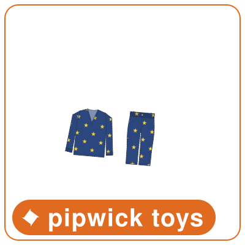
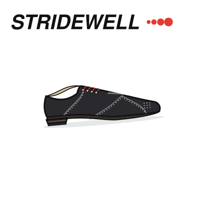
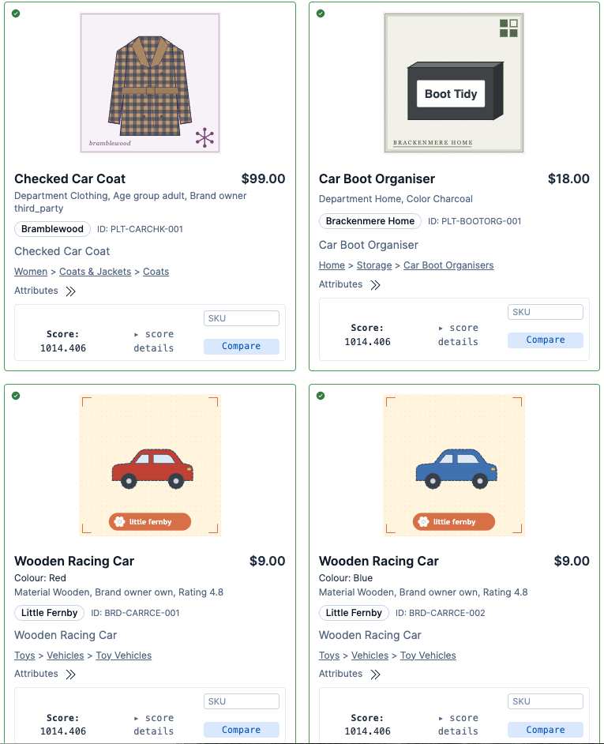
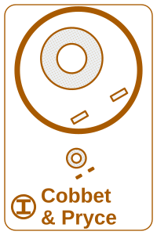
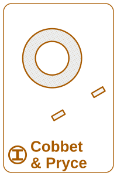
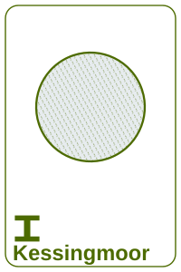

## Introduction

In two earlier articles I described how I turn open data into demo-ready e-commerce catalogs: [groceries from Open Food Facts](/data-generation/open-food-facts-grocery-demo-data/) and [electronics from Icecat](/data-generation/icecat-electronics-demo-data/). Both work because there is an open source with real products, real images and a licence that is clear enough to build on.

For two other kinds of catalog I could not find an equivalent. The first is industrial supply: end mills, drills, taps, socket cap screws, hex bolts, washers. The real catalogs in this vertical are the distributors' own product data, and none of it can be redistributed as a demo asset. The second is a general retailer: hundreds of thousands of SKUs, with clothing, home, beauty, toys, garden and electronics side by side. The open sources I use each cover one department, and I found no redistributable source that covers them all together at that scale. So instead of harvesting a catalog, I wrote a generator for one: [**synthetic-ecommerce-data**](https://github.com/alexander-marquardt/synthetic-ecommerce-data).

The generator builds one combined catalog of two domains, retail and industrial. The demo built on it serves **383,284 SKUs: 251,288 retail and 131,996 industrial**, each with a drawing of its own. Unless a figure says otherwise, the industrial figures below are from the default industrial build committed to the repository on 8 November 2026.

**Every product it produces is synthetic.** No record describes a real product offered by any retailer, every brand is invented, and no retailer's catalog content is redistributed. What *is* taken from the real world is the shape of the domain: which attribute names the industry uses, which dimension combinations are physically real, how clothing is sized, how titles are constructed, and how often real records are inconsistent.

## Why generate a catalog at all?

A synthetic catalog is usually the thing you settle for when you cannot get real data, and it tends to make demos less convincing: every field populated, every value well-formed, every title built from the same template. That is not what a real catalog looks like, and it does not exercise a search engine the way a real one does. The point of this generator is the opposite: a catalog that is awkward in the ways real catalogs are, at a rate that can be measured.

Industrial supply has one property in particular that is hard to fake convincingly: **attribute-role ambiguity**. The same dimension token legitimately appears in different roles on the same kind of product. A `3/8"` is the cutting diameter on one end mill and the shank diameter on another. A shopper searching for `3/8 end mill` wants the first and not the second, but full-text search matches both.

On the generated catalog, that is measurable. Of the 371 end mills that carry a `3/8"` value anywhere, 171 have a 3/8" cutting diameter, while 77 carry it as their shank diameter and have a different cutting diameter. A full-text match on the token returns all of them, and only a structured filter on the right attribute separates the two. Demonstrating that a search engine handles this correctly requires a catalog whose dimensions are internally coherent and whose collisions happen at a realistic rate, which is exactly what a naive generator does not give you.

Retail has its own version of the problem: **ordinary products that win a query on text alone**. A search for `belt` should not open with a belt sander, and a search for `cap` should not open with a pen cap, although on text alone both can. The retail side of the generator plants such products on purpose, so that a demo can show what a ranking or filtering policy fixes (see [Planted products](#planted-products-that-win-on-text-alone)). It also carries names that are not product words at all. A search for `the toy movie` is about a film, and its mugs, pyjamas and cakes sit nowhere near the Toys department; a search that reads `toy` as a category loses all of them (see [Invented films, characters and seasonal collections](#invented-films-characters-and-seasonal-collections)).

## One catalog, two domains

The generator builds each domain on its own and then composes them into **one catalog**. Both domains write the same output standard, a single set of document fields that a check validates before anything is written, and the composed catalog is refused if the two domains disagree: a `sku` or `product_id` that both use, or one attribute that the two name differently, fails the build. That is what lets one search deployment serve a sock and a socket head cap screw from the same index, with the same facet machinery.

The top level of every product's category path is its department, from one closed list per domain:

| domain | departments |
| :--- | :--- |
| retail | Womens, Mens, Kids, Food & drink, Home, Beauty, Cleaning, Toys, Gifts, Garden, Sports & outdoors, Electronics |
| industrial | Hardware, Tools, Workshop & safety |

No document carries a separate `department` field; a consumer reads it from the first element of `category_path`, so the department and the category tree can never disagree.

The generator itself is code, not a catalog: a domain's build is deterministic, and a release builds the large retail catalog and the large industrial catalog, composes them, renders every drawing into one image bundle, and pins both by content digest (see [Getting the data and the drawings](#getting-the-data-and-the-drawings)).

## The industrial catalog

With the default configuration, the industrial generator produces **7,357 product lines and 14,556 SKUs across 163 product types**, from 45 invented brands. Sixty of those types are the catalog's *depth*: from a handful to several hundred lines each, with realistic attribute schemas, messiness and drawings drawn from the record. The other 103 are *breadth*: one line of one to three SKUs per category, there so that a query like `1/2 ball` has more of the category tree to land in than end mills, hex keys and bearings. Breadth lines are marked on every record (`spec_quality: "fast_and_cheap"`) so they can be told apart and removed. The largest depth types:

| product type | product lines | SKUs |
| :--- | ---: | ---: |
| `end_mill_square` | 519 | 1,414 |
| `nut_hex` | 689 | 1,329 |
| `bearing_radial_ball` | 679 | 1,182 |
| `hex_key` | 638 | 1,178 |
| `wheel_depressed_center` | 658 | 1,162 |
| `end_mill_ball` | 309 | 910 |
| `screw_socket_head` | 322 | 708 |
| `drill_jobber` | 291 | 580 |
| `set_screws_hex_socket` | 267 | 535 |
| `bolt_hex` | 240 | 516 |
| `lock_nuts_nylon_insert` | 256 | 469 |
| `screw_flat_head` | 185 | 365 |
| `tap_spiral_point` | 180 | 342 |
| `screw_button_head` | 135 | 315 |
| `screw_low_head` | 108 | 241 |
| 45 more depth types (washers, flap discs, hammers, chain and sprockets, shackles, wrenches, safety glasses, gloves, casters, …) | | |
| 103 breadth categories (ball stock, threaded rod, hose clamps, ball valves, …) | 103 | 196 |

The default build is the one committed to the repository. One flag builds the large catalog: `--lines 39000` produces 48,761 lines and 176,345 SKUs today, and every type grows together. The demo's current pinned industrial release, built on 1 November, holds 131,996 SKUs.

### Product lines and SKUs

The data model follows how industrial catalogs are actually organised. **A parent is one manufacturer's product line, and its children are the individual purchasable SKUs.** Attributes that are constant across the line (brand, series, material, coating, flute count, end style) live on the parent; the ones that vary (cutting diameter, length of cut, overall length, shank diameter, price, stock) live on each SKU. Lines are never grouped across brands: two manufacturers' tools at the same nominal geometry are different products.

A distributor sells one cap screw (thread, material, finish) in a run of standard lengths, and one end mill or drill line in a run of diameters. So on twelve types (the socket cap screws, set screws, hex bolts, hex nuts, hex keys, square and ball end mills, jobber drills and spiral point taps), most products of a large build are **run lines** of 6 to 15 SKUs: a fastener takes a contiguous run of its thread's lengths, an end mill or drill a contiguous run of its system's diameters. Before that change, a search for `m6x1 set screws` returned 141 products for 260 SKUs, most of them a single variant, which gave a grouped results page almost nothing to group.

**Every SKU is different.** A SKU that its brand has already made, with the same values, is rejected and redrawn, so no two SKUs in the catalog are the same product under different ids. A type whose specification space is small (a washer standard fixes nine sizes; a hammer is its head weight and handle) runs out of new SKUs sooner, so it grows less in a large build.

Attributes are key-value pairs, and a measurement is split into its magnitude, its unit and a canonical number in the same entry:

```json
{"key": "milling_dia", "name": "Milling dia.", "value": "3/8", "unit_code": "INH", "value_canonical": 9.525}
```

`value` is the bare magnitude, `unit_code` is the only place the unit lives (a UN/CEFACT code: `INH` for inches, `MMT` for millimetres, `C62` for a count, `DD` for degrees), and `value_canonical` is the magnitude in the kind's canonical unit, here millimetres, so one range filter works across inch and metric spellings. The split is parsed *back out of* the published string rather than computed from the generator's own number, so the two can never disagree. The published spelling (`3/8"`) is kept in the flat shape's `facets`. An attribute that is not a measurement has no `unit_code` or `value_canonical` at all. Attribute names are written in one letter case (sentence case: `Milling dia.`, `Length of cut`), so a facet never shows the same name twice in two spellings.

### Two shapes from one catalog

A single build writes the same generated products in two shapes, so any difference in what they return is a property of the shape rather than of the data:

| file | shape |
| :--- | :--- |
| `nested.jsonl` | one document per product line, with its SKUs and key-value attributes nested |
| `flat.jsonl` | one document per SKU, with attributes denormalised, plus sanitised per-attribute `facets` (the published spelling) and `facets_num` (the number) fields |
| `images.jsonl` | one row per SKU drawing: its path, its URL, the sha256 of its bytes and their count, and whether its geometry came from the record (`record`, `partial` or `nominal`) |
| `stats.json` | what was generated, measured against the statistics it reproduces |

Elasticsearch mappings for both shapes (`mapping.flat.json`, `mapping.nested.json`) ship alongside them. Here is one SKU from the flat shape, trimmed to its interesting fields:

```json
{
  "sku": "7038390581",
  "product_id": "HOL-K701-7038-0001",
  "product_type": "end_mill_square",
  "product_type_label": "Square End Mill",
  "title": "High Speed Steel Square End Mill, 1/16\", HSS, 4 FL, SGL Sq End",
  "description": "High Speed Steel Square End Mill, 1/16\", HSS, 4 FL, SGL Sq End - 1/8\" Shank Dia., 3/16\" Length of Cut, Hollisdane K701. Listed in the Hollisdane K701 family. For slotting, profiling and facing on milling machines.",
  "parent_title": "Hollisdane K701 -- High Speed Steel Square End Mill",
  "brand": "Hollisdane",
  "series": "K701",
  "category_path": ["Tools", "Milling", "End mills", "Square end mills"],
  "dimension_provenance": "generated from the conventional tool series; no standard fixes these values",
  "spec_quality": "realistic",
  "price": 12.0,
  "currency": "USD",
  "in_stock": true,
  "pricing_unit": "Each",
  "image_url": "/images/industrial/end_mill_square/HOL-K701-7038-0001/7038390581.svg",
  "attributes": [
    {"key": "material", "name": "Material", "value": "High Speed Steel"},
    {"key": "number_of_flutes", "name": "Number of flutes", "value": "4", "unit_code": "C62", "value_canonical": 4.0},
    {"key": "helix_angle", "name": "Helix angle", "value": "45", "unit_code": "DD", "value_canonical": 45.0},
    {"key": "standards", "name": "Standards", "value": "ANSI B94.19"},
    {"key": "milling_dia", "name": "Milling dia.", "value": "1/16", "unit_code": "INH", "value_canonical": 1.5875},
    {"key": "shank_dia", "name": "Shank dia.", "value": "1/8", "unit_code": "INH", "value_canonical": 3.175},
    {"key": "length_of_cut", "name": "Length of cut", "value": "3/16", "unit_code": "INH", "value_canonical": 4.7625}
  ],
  "facets": {"milling_dia": ["1/16\""], "shank_dia": ["1/8\""], "length_of_cut": ["3/16\""], "helix_angle": ["45 Degrees"]},
  "facets_num": {"milling_dia": 0.0625, "shank_dia": 0.125, "length_of_cut": 0.1875, "helix_angle": 45.0}
}
```

The `facets` object exists because `Milling dia.` cannot be an Elasticsearch field name (the trailing dot makes it an invalid path), so each attribute gets a sanitised key of its own.

### Why the flat shape is not enough

The flat shape is easy to load, but it has a well-known weakness that the catalog makes visible. In the flat document the `attributes` array is a plain object, so `name` and `value` become two independent multi-valued fields and the pairing between them is lost. On the committed catalog, filtering for *name = `Shank dia.` AND value = `3/8"`* matches **384** documents, but only **202** of them actually have a 3/8" shank; the other 182 carry a 3/8" that belongs to some other attribute.

That is why the flat shape also carries the per-attribute `facets.*` keys, where the pairing cannot come apart, and why the nested shape exists at all: with nested documents and `reverse_nested`, "how many *products* have this value" becomes answerable.

## The retail catalog

The retail domain follows the same rules as the industrial one: no real retailer's content, deterministic output, one output standard, and a generated drawing for every SKU. The full retail build, which is what the demo serves, holds **251,288 SKUs in 16,248 products**: 505 product types under 679 category leaves, from 163 invented brands. A retail record is one product per style, with its colours and sizes as nested SKUs, so the departments differ as much in SKUs per product as in size:

| department | products | SKUs |
| :--- | ---: | ---: |
| Womens | 4,031 | 158,749 |
| Mens | 1,700 | 44,782 |
| Home | 2,424 | 13,892 |
| Kids | 719 | 12,795 |
| Food & drink | 4,535 | 12,244 |
| Beauty | 692 | 2,587 |
| Toys | 438 | 1,359 |
| Electronics | 221 | 1,166 |
| Sports & outdoors | 120 | 1,093 |
| Gifts | 387 | 958 |
| Cleaning | 543 | 835 |
| Garden | 438 | 828 |

*A product filed in two departments, such as a mug that is also a gift, is counted under the first.*

Clothing is where the SKUs are. A lingerie or nightwear style averages 91 SKUs (a bra's colours across its band and cup sizes), a shoe 31 and a garment 23, while a grocery product averages under 3, one per pack size. That spread matters for search: a results page of bras that does not group by style shows the same bra again and again, and a grocery page has almost nothing to group.

### Colours, sizes, shades and packs

Each product declares the axes its SKUs differ on (`variant_axes`): colour and size for most clothing, configuration for a sofa, shade for a foundation. The values are stored the way a filter needs them:

- **Clothing sizes in three systems.** A garment sized by number stores `size_uk`, `size_eu` and `size_us` from one chart (a women's UK 20 is EU 48 and US 16), so `size 20 dress` is a filter, not a text match. Jeans add their inside leg, in inches as sold and in millimetres as a canonical number for range filters.
- **Complexion products sold by shade, not colour.** A foundation, concealer or tinted moisturiser carries `shade` (`6N`, `Porcelain`), `shade_depth` (fair, light, medium, tan, deep) and `undertone` (cool, neutral, warm), and no `color` at all. A shopper asks for "foundation for medium skin, warm undertone", never for "red foundation", and a shade code in the colour facet would sit beside Navy and Black on every clothing query.
- **Volumes a facet can use.** Every product type that carries a net volume offers at least three, so a Net volume facet never shows a single option, and a title that states a volume ("Glass Cleaner 500ml") carries it as a value.
- **Packs.** A pack SKU knows its count (`units_per_pack`, `pack_size`), and its drawing shows that many items, so a six-pack does not look like one can.
- **Stable SKU ids.** A SKU id is its product id plus a hash of the values that tell it from its siblings, so adding a style to one range does not renumber another, and a repricing keeps the SKU. A partial reload can then write a SKU as its document id without overwriting a different product.

Here is one retail record in the flat shape, trimmed to its main fields. It is a mug from one of the invented films described below, filed in two places:

```json
{
  "sku": "BRD-KFPSMG-AD722269",
  "product_id": "BRD-KFPSMG",
  "title": "Plaything Story Stoneware Mug",
  "brand": "Brackenmere Home",
  "description": "A 350 ml stoneware mug printed with the toy box gang from the Plaything Story movie. Dishwasher safe.",
  "product_type": "Mug",
  "category_path": ["Home", "Kitchen & dining", "Drinkware", "Mugs"],
  "category_paths": [
    ["Home", "Kitchen & dining", "Drinkware", "Mugs"],
    ["Gifts", "Mugs & drinkware"]
  ],
  "price": 9.0,
  "currency": "GBP",
  "in_stock": true,
  "facets": {
    "color": ["White"],
    "brand_owner": ["own"],
    "rating": ["4.8"],
    "review_count": ["137"],
    "sold_last_5_days": ["22"]
  },
  "variant_axes": ["color"],
  "image_url": "/images/retail/mug/BRD-KFPSMG/BRD-KFPSMG-AD722269.svg"
}
```

### What makes it useful for search

- **An audience on every worn product.** Every SKU of clothing, footwear and lingerie, or under the Womens, Mens or Kids roots, carries exactly one `audience` (`Womens`, `Mens`, `Girls`, `Boys`, `Baby` or `Unisex`), so a search layer can turn "for men" into a filter instead of a text match. The roots are spelled as shoppers say them; the generator derives no spelling variants (mens, men's, men), which are the search layer's vocabulary to own.
- **Facets that mean one thing.** One concept has one attribute key across every product type: a measured height is `item_height` on a sofa, a lamp, a doll and an olive tree alike, and a check refuses a second key for the same concept. A fit or a bra style is a filter, not a category leaf, and a fabric is a fibre or weave from one closed list ("98% Cotton, 2% Elastane" leaves `Cotton` as the fabric and moves the blend to a detail field).
- **Text that agrees with its facets.** A description that says "magnetic fastening" over a style whose closure is a zip, or a polka-dot umbrella sold in gingham, is refused by a check that runs on the whole build, and a title that names a value its category does not hold is refused too. A "Small Check Bomber Jacket" stores its check as `pattern`, and its drawing has a check swatch.
- **A product in more than one place.** A mug is kitchen drinkware and a gift, so it is filed at both paths, as one product with one listing (1,301 SKUs are filed this way). A category facet counts it once and a filter on either path finds it.
- **Grocery with structured claims.** A food product carries an invented ingredient list (`ingredients`), the allergens it contains (`contains`) and its dietary claims (`dietary`: Vegetarian, Nut Free, Gluten Free, Dairy Free, Vegan, Organic), each per SKU, so a chocolate bar's milk flavour and its peanut caramel flavour make different claims.
- **Sales and business signals.** 20,346 SKUs, about 8%, carry a was-price and the promotion value "On sale", from 9% of womenswear to 25% of babywear, and 6,695 of those also belong to a seeded campaign, "Christmas promotion". About half the SKUs carry a rating, a review count, units sold in the last five days, and whether the product is the retailer's own brand or a third party's: the signals a ranking policy boosts on.

### Invented films, characters and seasonal collections

Retail search is full of names that are not product words: a film on a lunch box, a cartoon range on a pair of pyjamas, a season on a candle. The catalog carries three kinds, and each is a different problem for a search layer.

**Merchandise of twelve invented kids' films**, 350 SKUs in all: Plaything Story, Lovely and the Beast, Duck Run, Really Cold, Little Tiny Queen, Home Without Anybody, The Blue Balloon, The Toy Movie, Frozen Story, The Home Run, The Lady in High Heels and The Haunted Dollhouse. Each sells in seven or more categories, from mugs, tees and pyjamas to duvet sets, party bags, birthday cakes and sweets. No structured field holds the film: the products keep the brand of the house that makes them and sit in the categories of their type, and the film is named only in their text ("a mug from the Plaything Story movie"). The names are built to collide with the rest of the catalog:

- `duck`, `cold`, `home` and `blue` are ordinary catalog words, and `story` is in no product at all, so a spelling corrector will try to rewrite it. The phrase has to be kept together.
- Five names hold a category word, and none of those films sells in that category: The Toy Movie sells nothing under Toys, Frozen Story nothing frozen, The Home Run nothing in the Home department or among running shoes, The Lady in High Heels no shoes, and The Haunted Dollhouse no dolls. A search that turns the name into a category filter loses every one of the film's products.
- The Blue Balloon comes in many colours: a red mug, a yellow tee, a green sweatshirt, red party bags. One of its twelve coloured SKUs is blue, so `the blue balloon` has to stay a name and not become the colour Blue.
- One product of each of seven films names the film in its description only, so a search has to rank a description match against title matches of the same film.

Each film has one emblem, an original drawing printed on every product it sells, with a "Licensed from … Studios" line beside it, so the results of a film search can be seen to belong together.

**Four invented character ranges**, Moonmoth Rangers, Rumblesaur Ridge, Hazelwren Owls and Driftwhistle Bay, work the other way: the range is a structured value (`line`, shown as Range) on building sets, jigsaws, board games, pyjamas, soft toys, cakes and sweets. A search for `moonmoth rangers` can become one filter that finds a space base building set, a pair of pyjamas printed with the range's stars, and a birthday cake, across three departments.

**Seasonal collections** are a `collection` facet (Christmas, Halloween, Advent, Summer, Autumn, Wedding, Going Out) on the products that belong to one: a festive jumper, a cranberry and clove candle, Christmas wrapping paper, chocolate and beauty advent calendars, Halloween cupcakes, a trick-or-treat bucket bag, a satin slip dress for weddings and going out. Beside them, colour values that are also a food, a stone or a fabric (champagne, duck egg, rust, caramel, oatmeal, aubergine, raspberry, mint, olive, rose quartz) are put on the products a shopper types them before, so `olive dress` and `olive oil` both have to work.

| | | |
| :---: | :---: | :---: |
|  |  |  |
| Plaything Story mug | The Blue Balloon party bags, in red | Moonmoth Rangers pyjamas |

### Planted products that win on text alone

Real catalogs are full of products that match a query's words and are not what the shopper meant: a "Leather-Look" garment for `leather`, a belt sander for `belt`, a pen cap for `cap`, a brand whose name holds a colour word for a search on that colour. The retail generator plants such products deliberately, from a table of decoy classes, and a check refuses a planted product that cannot actually outrank the best intended product on plain BM25 text scoring. With no ranking or filtering policy, the decoys sit near the top; with the right policies, they move out of the best results. That gap is the demo, and the catalog guarantees it exists.

One class puts the shopper's product noun on a different product: "Dress for Success" shoes for `dress`, a sofa cover for `sofa`, red jumper cables for `jumper`, black bow tie pasta for `tie`. The structured fields tell the truth (category, product type, colour, drawing), and the title names at most a misleading colour ("Dress for Success, Red Laces" are black shoes with red laces, and the drawing has the red laces). A policy that reads the structured fields, such as a category filter on Dresses, drops the decoy; text scoring alone does not.



### Every brand is invented

All retail brands are invented, including the ones that stand in for famous names a shopper would type. The sportswear brand is **Knacks**, with a running-shoe line called **Breeze Max**; the computer maker is **Grape Computer**, whose phone is the **GrapePhone**; the large-appliance makers (Frostholm, Brimwell, Tavorne and others) are invented too. A guard in the test suite refuses a list of real brand and model names in any brand, title or description. A search layer that wants a shopper's `iphone` to find the GrapePhone does it with a vocabulary entry, which is exactly the kind of mapping a real deployment has to make for its own brands.

A few brands sell across departments, so a shopper can follow one brand from a laptop to a fridge: Grape Computer sells laptops, desktops, phones and their cases and keyboards; SingingSam sells TVs, washing machines, fridges, phones and a laptop; PackingHarder sells monitors, computers and volt meters. A brand filter on them has to work across category trees that share nothing else.

Like the industrial brands, some retail brand and line names hold an ordinary word on purpose, including colour words that do not describe the product (its colour attribute stays true): a brand filter has to tell a brand from a word, and a catalog without such names never makes it. Model names follow how public listings name a model, a plain lead word before the kind ("Bramblewood Anytime Underwired Balcony Bra", "Knacks Breeze Max 90 Trainers"), and a lead word belongs to one product family only, so a model name does not read as a second brand.

### Building retail at a size

The retail build takes a target SKU count and stops at the first style past it, so a smaller build is a prefix of a larger one:

```sh
uv run python -m synthetic_ecommerce_data.domains.retail.scale --skus 20000 \
    --out out/retail/nested.jsonl --flat out/retail/flat.jsonl
```

`--skus ceiling` builds everything the retail tables can make, which is what a release ships. On a laptop the full build of 251,288 SKUs takes about a minute.

## Where the realism comes from

### Observed statistics, generated products

For industrial supply, the **schema** and the **statistical distributions** are derived from observing publicly archived catalog pages of a real industrial distributor: attribute names, which dimension combinations occur together, how often roles collide, how titles are built, and how often records contradict themselves. Those are facts about the domain. The **products** are generated; they are not real records with the names changed.

That distinction is enforced rather than asserted. The repository ships *hashes* of the reference records' full attribute tuples (never the records themselves), and the test suite checks that no generated product matches any of them. The comparison is over the whole tuple rather than field by field, because agreeing with a published standard on one dimension is not copying (every real `#10` flat head cap screw has the same head diameter), whereas reproducing a complete record would be.

For retail, the starting point is the queries rather than a census of one catalog. Thirteen kinds of query that go wrong were observed by hand on a live retail site, and the catalog is built so that each one can be reproduced on Elasticsearch, then fixed by a policy. Among them:

| what goes wrong | query | on text alone, the top results include | after the policy |
| :--- | :--- | :--- | :--- |
| a fruit plural read as a flavour and a colour | `oranges` | Cranberry & Orange Panettone, Chocolate & Orange Cookies, Orange Rose Bouquet | Blood Oranges, Navel Oranges, Seedless Easy Peelers |
| a neckline word matched as a keyword | `womens boat neck top` | High Neck Ribbed Top, Crew Neck Cotton Top, Tie Neck Top and Trousers Set | Striped Boat Neck Top, Boat Neck Jersey Top, Slash Neck Long Sleeve Top |
| a pack count spelled only in titles | `5 pack socks` | Cotton Rich Socks 7 Pack, Striped Cotton Socks 3 Pack | Bamboo Socks, Pack of 5; Sports Trainer Socks 5 Pack; Cotton Rich Ankle Socks 5pk |
| a two-word colour split into words | `rose gold` | Blush Rose & Gold Eucalyptus Bouquet, White Rose Bouquet with Gold Foliage | rose gold earrings, a watch, a charging pad, a table lamp |
| one word with a sense in two departments | `cups` | Moulded Cup T-Shirt Bra, Lace Demi Cup Bra, Car Cup Holder Organiser | a travel cup, an espresso cup set, a tea cup and saucer, mugs |

Titles follow how public retail listings name a product, with every brand and model name invented.

### Dimensions: standards for fasteners, conventional series for cutting tools

The two halves of the industrial catalog get their dimensions differently, and every product line says which:

- **Fasteners** are **standards-derived**. Each line carries the standard its dimensions came from (`ISO 4762`, `ISO 7089`, `DIN 933`, `ASME B18.3` and so on). The values were extracted from open-source CAD fastener libraries, primarily the [FreeCAD Fasteners workbench](https://github.com/shaise/FreeCAD_FastenersWB), with [BOLTS](https://github.com/boltsparts/boltsparts) as corroboration, rather than transcribed by hand, and only the sizes the catalog offers were taken. A size the sources do not carry is absent rather than invented.
- **Cutting tools** are **generated** from the conventional size series. There is no open dimensional source for end mills, so nothing on those lines claims a standard, and the provenance field says so in words (you can see it in the record above).

The asymmetry is deliberate: a cap screw's head is fixed by a published standard and a catalog that disagrees with it is wrong, while an end mill's length of cut is a manufacturer's choice within a conventional range.

### Realistic messiness, within limits

Real catalogs are messy, and a search demo on a perfectly clean catalog proves very little. The generator reproduces the defect classes found in the reference data rather than smoothing them away: inconsistent unit formatting within a record, ragged attribute coverage, unlabelled dimension tokens in titles, and repeated attribute pairs. Each rate is reproduced against its own denominator (the records that actually carry the attributes involved), and `ecom-generate report` prints what was achieved beside the target:

| measured property | reference data | target | achieved |
| :--- | ---: | ---: | ---: |
| shank diameter == cutting diameter | 0.6489 | 0.6489 | 0.6218 |
| unit mixing within one record | 0.0222 | 0.0222 | 0.0171 |
| a parent repeats a (name, value) pair | 0.0085 | 0.0085 | 0.0085 |
| title dimension token carries no label | 0.4667 | 0.4667 | 0.4591 |
| title dimension token is not the primary dimension | 0.1714 | 0.1714 | 0.1245 |
| length of cut > overall length | 0.0829 | 0 | 0 |
| an angle attribute carries a length unit | 0.0469 | 0 | 0 |
| declared measurement system contradicts the value's units | 0.0323 | 0 | 0 |
| image reference missing | 0.1089 | 0 | 0 |
| attributes per record (mean) | 13.12 | 13.12 | 10.47 |

The rows with a target of 0 are deliberate. Each of these is an error a real retailer would fix once it was noticed: an end mill whose length of cut is longer than the tool, or a facet that offers `2"` beside `118` degrees, is a bug in the data, not realism worth demonstrating. The same goes for the measurement-system attribute, which the reference data spells three different ways: the generator publishes it under one name. The report also checks prices against a measured price census, per product type: the median price, the spread, how often a larger size costs more, how much brands differ for the same specification, and even the mix of price endings.

Titles vary the way real ones do. These are nine square end mills, one SKU from each of nine different product lines:

```text
High Speed Steel Square End Mill, 1/16", HSS, 4 FL, SGL Sq End
Solid Carbide Square End Mill, 1/2", Solid Carbide, 2 FL, SGL Sq End
End Mill, 1" Milling Dia., 1-1/2" Cut L, Solid Carbide, nACo, 4 FL
Industrial High Speed Steel Square End Mill, 1mm D, HSS, TiN, 2 FL, SGL Sq End
Quillon Carbide Cobalt Square End Mill, 1", Cobalt, TiAlN, 4 Flutes
Iron Heron Cobalt Square End Mill, 2.50mm Milling Dia., Cobalt, AlTiN, 2 FL
Workshop End Mill, 1", Co, AlTiN, 2 Flutes, SGL Sq End
Dravenholt Cobalt Square End Mill, 3/4", Cobalt, Bright, 2 FL
Dravenholt High Speed Steel Square End Mill, 16mm, High Speed Steel, TiN, 2 FL
```

The diameter is labelled `Milling Dia.`, `D`, or not at all; the length of cut is `Cut L`; the material is `High Speed Steel` or `HSS`, `Cobalt` or `Co`; the flute count is `FL` or `Flutes`; and the brand's name appears in some titles and not others. Each brand spells a label one way, as a real manufacturer's catalog does. All of that is something a query parser has to cope with. Within one product line the titles share a template and differ in the value that tells the SKUs apart, as they do in a real catalog's series.

The messiness is bounded by a few rules that keep the catalog usable. Every title names a value that is unique to that SKU within its line, so no two SKUs in a line share a title or a description. The description opens with the title verbatim and then continues with the remaining distinguishing attributes, which is the convention real listings follow: the title tells SKUs apart at a glance, the description while scanning, and the attribute block precisely. And a title or description that names a value its own attributes contradict is refused, except for the decoys planted on purpose.

## Generated drawings

A demo catalog without images is not a demo catalog, and product photography is exactly the content that cannot be borrowed. Photographs of a generated product cannot exist, since the product does not, and a picture taken from somewhere else would show a real product the record does not describe. So the generator also draws the pictures, and it draws them from the records.



*Search results for "car" in the demo search UI. Every picture is a generated drawing.*

**The pictures are drawn by code.** Each one is written straight to SVG, from the SKU's own attributes, by a small writer in the generator: no image model, no photographs, and no copied clip art. (One early drawing, a C-clamp, was a public-domain file; it has since been redrawn in code like the rest, and a test refuses any SVG file in the source tree, so a copied drawing cannot come back.) A drawing is deterministic, so the same record always gives the same bytes, and it costs nothing per variant. It is parameterised by product type, brand house style and attributes such as colour, pattern and size. It is also fast: on an Apple M3 Pro laptop the industrial drawing step runs at roughly 7,000 drawings a second on one core, or 0.14 ms each.

**Every SKU has a drawing of its own, drawn from that SKU's own values.** The default industrial build has 14,556 SKUs and 14,556 drawings; the demo's image bundle holds 383,284 files, one per SKU of both domains. Two lengths of one socket head cap screw therefore look different, and a grouped product page can switch the picture when a shopper picks a different size. That is a deliberate departure from real distributor catalogs, which mostly show one photograph for a whole series. A generated drawing costs nothing per size, so there is no reason to copy that habit.

| M10 × 40 mm | M10 × 55 mm | M4 washer | M20 washer |
| :---: | :---: | :---: | :---: |
|  |  |  |  |

The first two are SKUs of one product line, a stainless M10 socket head cap screw at two lengths; the second two are SKUs of one brass flat-washer line. Under each figure is the brand plate, described below. Every drawing in this article is the generator's output, byte for byte, rendered from the committed catalog on 8 November 2026, and each is under 5 KB of SVG.

### What "parameterized" means here

Each drawing is a pure function of three things: the product type, the brand, and the SKU's published attributes. Nothing is random, so the same record always produces the same bytes. An industrial drawing is built in three steps:

1. **Attributes to geometry.** Every drawn product type has a figure function that reads the record's published values (thread size and length for a screw; diameter, length of cut and flute count for an end mill; bore, outside diameter and closure type for a bearing) and builds the part as shapes measured in inches. It reads those values through the same parsing code as the rest of the generator, so the drawing and the data cannot disagree about what a record says.
2. **Geometry to sheet.** The part is placed on a 200 × 300 sheet at its product type's scale, above the brand's plate (the strip at the foot of the sheet).
3. **Sheet to SVG.** A small SVG writer in the generator itself, plain Python, writes out the paths, circles and fills. No drawing or plotting library is involved. A plotting library's SVG carries metadata and glyph definitions that these drawings do not need. The hand-written output averages about 2.6 KB per drawing: the default build's 14,556 drawings come to 38 MB, and the largest is under 8 KB.

The specifications show up visually rather than as text. A longer length of cut is drawn longer and a finer thread with more crests. A flat head is drawn as a cone and a button head as a dome. A sealed bearing is drawn closed, while an open one shows its balls. The other visual channels map to the record in the same way:

| channel | driven by |
| :--- | :--- |
| shape and proportions | the SKU's own dimensions |
| flutes and thread crests | the published flute count and thread pitch |
| fill tint | the finish (TiAlN is violet-grey, TiN gold, black oxide dark), otherwise the bare material's colour |
| section hatch | the material, as engineering drawings already denote it |
| outline ink and frame | the brand's house style |
| brand plate | the brand's mark and name |
| angle on the sheet | the product: every SKU of a product shares one |

Each of the 45 industrial brands owns one house style (an ink and a frame, with no two brands sharing both) and one mark, a machine-shop motif in one of three enclosures, which sits with the brand's name in the plate under the figure. A brand's drawings look like a set and two brands' drawings look different, which is the role a manufacturer's photography style plays in a real catalog. Every drawing, industrial and retail, sits on the same plain white paper: an earlier version gave each brand a tinted paper, and in a demo a green sheet read as a different kind of product from a blue one, which is a signal no shopper should get from a background.

The angle needs a word, because random rotation would be decoration. Two products of one type from two brands drawn at the same angle look like one product that should have been grouped, so each product's figure is turned to an angle derived from its product id, over the angles its type allows: any clock position for a part with no natural up (a screw, a washer), a small tilt for something that looks wrong upside down (a vise, a sofa) or for clothing, and level for a set of several items. Every SKU of one product shares the angle, so a product's variants still look like one product, and two different products look like two.

### One drawing, in code

This is the complete figure function for a flat washer:

```python
def washer(record: Record) -> Drawn:
    geom, source = _read(record, washer_geom.geometry_from_record, {}, WASHER_NOMINAL)
    od, i_d, t = geom.outside_d.inches, geom.inside_d.inches, geom.thickness.inches
    fig = Figure(size_in=od)
    P.ring(fig, (0.0, 0.0), od / 2, i_d / 2)
    edge = od / 2 + 0.35 * od
    P.tube(fig, od / 2, i_d / 2, edge, edge + t)
    return Drawn(fig, source)
```

`_read` takes the outside diameter, the inside diameter and the thickness from the record. It falls back to a nominal proportion only for a value that is missing or inconsistent, and it reports which happened as `source`. The function draws the face as a ring and the edge view as the two bars of a tube in section; everything else (scale, angle, colour, hatch, frame, brand plate, lens) comes from the shared layers. The face of the M20 washer above comes out as these elements, with line breaks added:

```xml
<pattern id="h45s3a85a00" width="3" height="3" patternUnits="userSpaceOnUse">
  <g stroke="#a85a00" fill="#a85a00" opacity=".45"><path d="M0 0V3" stroke-width=".5" transform="rotate(45 1.5 1.5)"/></g></pattern>
<g transform="rotate(330 100 118)">
<circle cx="100" cy="96.3" r="50.3" fill="#eceff1" stroke="#a85a00" stroke-linejoin="round" stroke-width="2.3"/>
<circle cx="100" cy="96.3" r="50.3" fill="url(#h45s3a85a00)"/>
<circle cx="100" cy="96.3" r="28.6" fill="#ffffff" stroke="#a85a00" stroke-linejoin="round" stroke-width="2.3"/>
```

The pattern is the section hatch for brass, a 45° line every 3 units in the brand's ink, and the `rotate(330 …)` is this product's angle. The washer type is drawn at about 69 sheet units per inch, so a 37 mm outside diameter becomes a radius of 50.3 and the 21 mm bore a radius of 28.6. The bore is filled with the paper's white, so it reads as a hole. The M4 washer of the same line is the same elements with smaller radii, under a lens.

The writer keeps an ordered list of elements, registers each hatch pattern once in a `<defs>` block, and joins the lot into one string. Every coordinate is printed with at most one decimal, attributes are written in a fixed order and pattern definitions are sorted by id, so the same record produces the same bytes on any machine, which is what lets `images.jsonl` pin each drawing by its sha256. Nothing in the pipeline rasterizes an SVG: a record's `image_url` points at the SVG itself, and the browser draws it at whatever size the page needs.

### The honesty rules

The drawings follow a few rules, and the generator's tests check each one over the committed catalog:

- **No text but the brand's name.** A drawing carries no dimension, callout, label or SKU. The one piece of text is the brand plate: the brand's mark beside its name, in a strip at the foot of the sheet, where it never covers the part. The plate is set large enough to read at a search-grid thumbnail, and a name that does not fit is refused rather than shortened. The other words are already on the record (title, description, attributes), and repeating them in the picture would be redundant, and would also tie a drawing to wording that can change. The check is an allow-list of the SVG elements and attributes the figures emit, rather than a search for text, so a `<title>`, a comment, an embedded font or an external reference all fail it, and a `<text>` passes only when its words are a brand's name.
- **One true scale per product type.** Every SKU of a type is drawn at the same scale, so any two parts of a type are in true proportion. The M4 and M20 washers above are 9 mm and 37 mm across, and they are drawn in exactly that ratio. A screw or bolt longer than its type's sheet is drawn broken, with its shank shortened between two drafting break lines, rather than shrunk.
- **A magnifier for tiny parts, never an enlargement in place.** A part too small to see at its type's scale is still drawn at that scale, near the bottom of the sheet, and a lens above it shows the same part enlarged. The lens is a magnifying glass where the glass can enlarge the part at least 2.5 times, and a larger, handle-less circle otherwise; the M4 washer above gets the circle, and an M3 × 5 mm cap screw the glass:

  

- **The drawing cannot contradict the record.** Real catalogs omit attributes, and this one deliberately does too. When a drawn value is missing, unparseable or contradicts another value, the drawing falls back one step at a time: it first fills an absent value with a proportion of the record's own primary dimension (an end mill's missing length of cut is 2.5 times its diameter), then rebuilds every defaultable value that way when two published values contradict each other, then keeps only the primary dimension, and only as a last resort draws the kind's nominal shape. Every value the record does publish consistently is drawn exactly. Because the drawing carries no numbers, a nominal proportion never asserts a size that the record disputes. The manifest records, per SKU, whether the drawing came entirely from the `record`, was `partial`, or is `nominal`, so the share is reported rather than hidden.

| drawing, default industrial build | SKUs |
| :--- | ---: |
| drawn entirely from the record | 11,388 |
| drawn from the record, with a nominal proportion for a missing or inconsistent value | 2,972 |
| nominal: a fixed shape (the breadth categories) | 196 |

All 60 depth types have a figure of their own. The 103 breadth categories are drawn as one of eleven fixed shapes: six plain solids (a sphere, a cylinder, a block, a disc, a tube, a bracket) and five products that would otherwise have read as a box (a C-clamp, a ball valve, a bench vise, a thread pitch gage and a T-slot nut). Each is coloured and hatched from the record's material and finish like any other drawing, and a product's larger sizes are drawn larger, by their rank in the product's own size ladder. The rank says bigger or smaller and asserts no dimension, which is the honest choice for deliberately cheap filler data.



### Retail drawings

Retail products are drawn the same way, by code and from the record, but from a much wider vocabulary of shapes: every product is drawn as its own kind (a bouquet as roses in a paper cone, socks as socks, a bed as a bed), and a garment as the garment its category names (a bomber, a puffer, a shirt dress). A generic shape, such as a box, is allowed only where it is honest (packaged food in a box, loose produce as round produce), and a test names any product that uses one elsewhere. A "Checked" or "Striped" title gets a gingham or stripe swatch, and each colourway is drawn in its colour.


What a retail drawing shows is keyed by the style and colourway, the size (a smaller size of a product draws smaller), and the pack count (a pack of four draws four items). Every SKU still gets **its own file**, even where two SKUs draw the same picture, so one SKU's colour or size can change later without moving another SKU's image. The release refuses a broken set: a file that two SKUs name, a SKU with no file, or a file that no SKU names.

## Getting the data and the drawings

The generator is a Python package managed with [uv](https://docs.astral.sh/uv/). A build is deterministic: one seed produces one catalog, byte for byte.

```sh
git clone https://github.com/alexander-marquardt/synthetic-ecommerce-data.git
cd synthetic-ecommerce-data
uv sync
uv run ecom-generate build --out out/catalog   # the industrial catalog: the files above
uv run ecom-generate report                    # the measured-vs-target table only
```

Everything is parameterised, because the point of a synthetic catalog is to be dialled until something breaks:

```sh
uv run ecom-generate build --lines 900               # a bigger or smaller industrial catalog
uv run ecom-generate build --lines 39000             # the large build
uv run ecom-generate build --sparsity 0.4            # raggeder attribute coverage
uv run ecom-generate build --defects 0.0             # no unit mixing or repeated pairs
uv run ecom-generate build --seed 7                  # a different catalog
```

`--lines` is the one size knob for industrial: every type grows together. `scripts/check_determinism.py` builds twice in fresh interpreters with different hash seeds and compares the sha256 of every emitted file, which is how the "byte for byte" claim is checked.

The two domains are composed into one catalog, and the drawings of both rendered into one bundle, with:

```sh
uv run ecom-generate compose --domain industrial=out/catalog --domain retail=out/retail --out out/combined
uv run python -m synthetic_ecommerce_data.domains.retail.image_release --skus 20000 \
    --industrial-catalog out/catalog --out out/images --archive out/images.tar.gz
```

For the industrial drawings alone, `ecom-generate images --catalog golden-catalog --out out/images --archive out/images.tar.gz` rebuilds every drawing from the committed catalog. Both commands refuse to finish unless the bundle matches the catalog, so a bundle can never drift from the catalog it belongs to. The archive is deterministic, and what you pin is the content digest the command prints (the sha256 of the sorted member paths and file digests), because the compressed bytes depend on the zlib build. Each record's `image_url` is relative (`/images/industrial/…` or `/images/retail/…`), so a demo unpacks the bundle and serves it itself.

A release is a version tag: it builds the full retail catalog and the large industrial catalog, composes them, renders the one image bundle, publishes both with their digests, and opens a pull request that moves the demo's pins to them. A change to the generator reaches the demo through that pull request, never by hand.

If you just want industrial data, you do not need to run anything: the default industrial build is committed to the repository under `golden-catalog/`, as plain NDJSON so that a change to the generator shows up as a readable diff. Loading the flat shape into Elasticsearch takes the committed mapping and a bulk request:

```sh
ES=http://localhost:9200
curl -X PUT "$ES/industrial-products" -H 'Content-Type: application/json' \
  --data-binary @golden-catalog/mapping.flat.json

jq -c '{index: {_id: .sku}}, .' golden-catalog/flat.jsonl > bulk.ndjson
curl -X POST "$ES/industrial-products/_bulk?refresh=true" \
  -H 'Content-Type: application/x-ndjson' --data-binary @bulk.ndjson
```

For a larger catalog, split `bulk.ndjson` into chunks (for example with `split -l 2000`) so that no single request gets too large.

The repository also contains a verification script, `scripts/verify_elasticsearch.py`, that loads both shapes into a local test cluster and checks that every number Elasticsearch returns (facet counts, range filters, the `3/8"` shank-versus-cutting-diameter case) equals one computed independently in Python from the generated objects. The drawings browsable under [E-commerce Demo Assets](/ecommerce-demo-assets/images/industrial/) on this site are a small sample from an earlier version of the generator, with the line's attributes printed beside the part; they are not what the current catalog points at.

## What's next

The catalog keeps growing in both domains, and each addition follows the same pattern: a new product type is a specification and a figure function, measured against what real catalogs do, and the large builds and the demo pick it up at the next release. The breadth categories are the obvious place for more depth: each one that gets a figure of its own becomes a drawing that changes with its specifications. I will update this article as the larger changes land.

## Conclusion

Open Food Facts and Icecat give me real products for groceries and electronics. For industrial supply there is no open equivalent, and for a general retailer at this scale there is none I can redistribute either, so the next best thing is a generator that is honest about what it is: synthetic products, whose schema, distributions, messiness and even pictures are derived from, and checked against, how real catalogs in the domain behave. The result is one catalog of retail and industrial products that is safe to share, reproducible from a seed, and awkward in all the ways that make a search demo worth watching.
